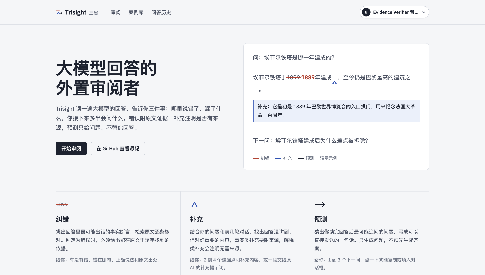
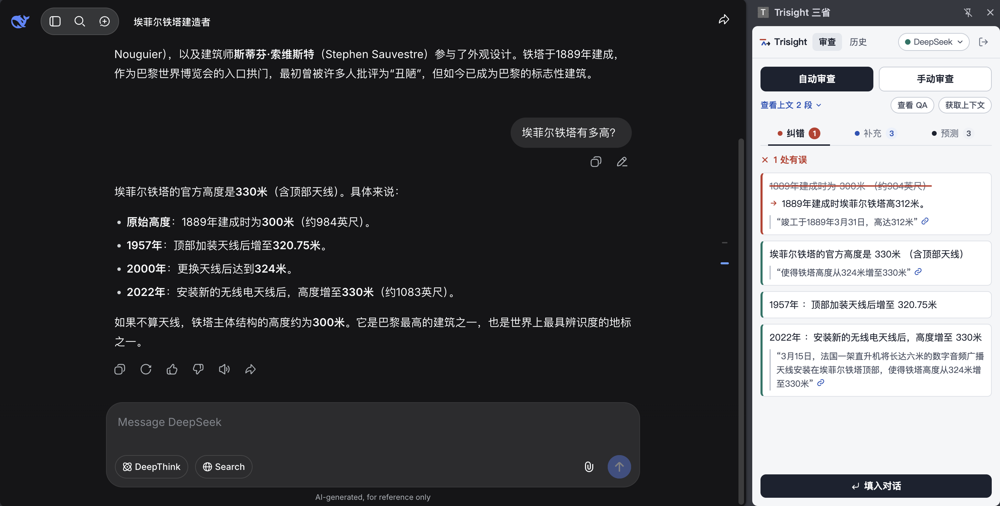
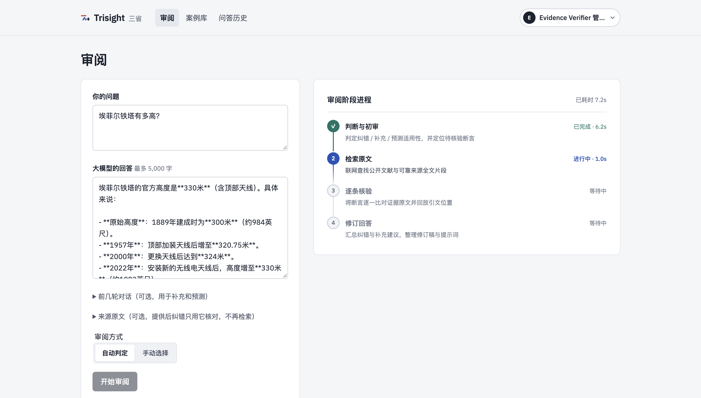
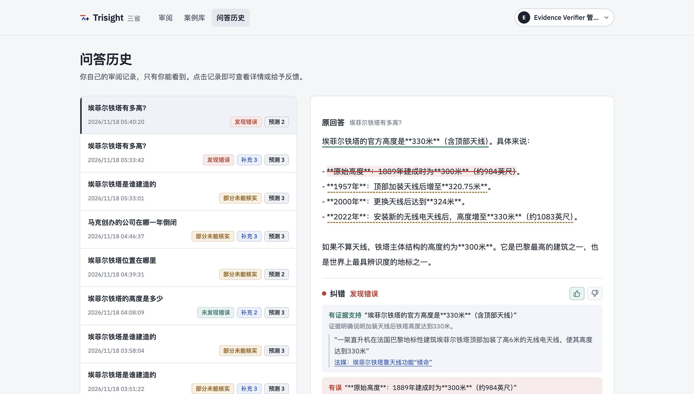
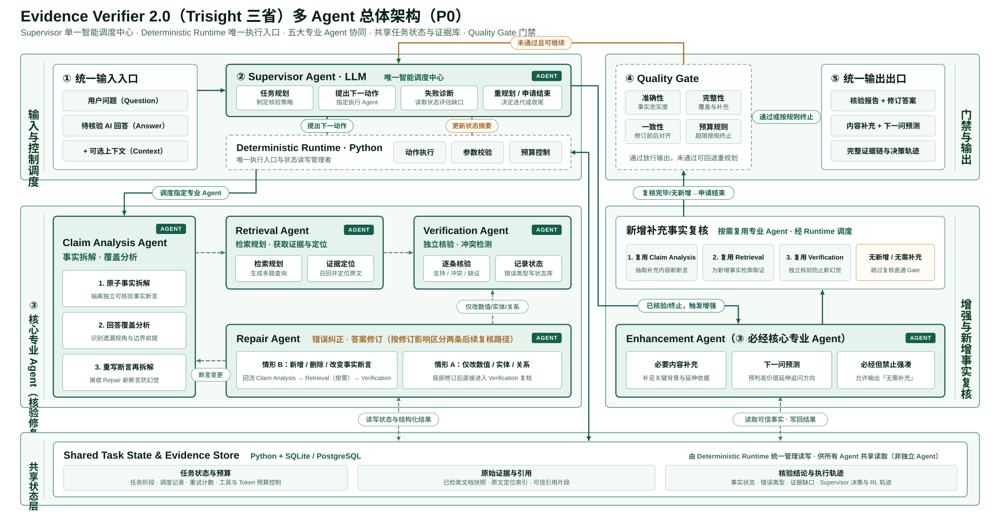

<div align="center">

# Trisight 三省 · Evidence Verifier

**大模型回答的外置审阅者（纠错 · 补充 · 预测）与可信多 Agent 事实核验架构**

[](LICENSE)
[](app/README.md)
[](https://evidence-verifier.edgeone.dev/)
[](app/extension/README.md)
[](#5-系统架构与-evidence-verifier-20-演进)

[在线工作台](https://evidence-verifier.edgeone.dev/) · [下载浏览器插件 v0.6.6](https://evidence-verifier.edgeone.dev/downloads/evidence-verifier-extension.zip) · [核心能力](#2-核心能力与展示) · [Chrome 伴随插件](#3-chrome-伴随插件v066) · [EV 2.0 多 Agent 架构](#5-系统架构与-evidence-verifier-20-演进) · [快速开始](#7-快速开始)

</div>

---

**Trisight 三省（Evidence Verifier）** 是一个面向 AI 对话与长文输出的外置事实审查与阅读辅助系统：当大语言模型给出回答后，三省不替换主模型，而是在旁侧同步完成**原子事实拆解、独立证据取证、冲突核验、最小粒度修订、完整性补充与下一问预测**，并以 **Chrome 侧边栏伴随插件**、**Web 审阅工作台** 和 **Python/HTTP 验证内核** 三种形态交付。

<p align="center">
  <a href="https://evidence-verifier.edgeone.dev/">
    
  </a>
</p>

> [!TIP]
> **直接体验在线版本**：访问 **[https://evidence-verifier.edgeone.dev/](https://evidence-verifier.edgeone.dev/)** 可直接使用三省工作台、预设案例库与历史审查记录；安装 Chrome 伴随插件后，可在 **DeepSeek / ChatGPT / Claude / Gemini** 对话页面右侧实时同步审查。

> [!NOTE]
> **开源仓库范围说明**：本仓库公开发布 Web 工作台、Chrome MV3 伴随插件（`v0.6.6`）、EdgeOne 代理部署与基础版 Python EV 核验内核；**Evidence Verifier 2.0 完整多 Agent 运行时、闭环评测管线及策略训练实现因商业保密暂不随本公开仓库释放源码**，本页面中的 2.0 架构图与机制说明用于展示当前系统演进全貌与工程规范。

---

## 1. 为什么做三省（Trisight）？

主流对话模型已经很擅长流畅作答，但在严肃检索、决策辅助与专业知识场景中仍有三个痛点：

1. **细节幻觉难察觉**：回答看似通顺，但年份、数据、人物归属或因果限定往往悄悄偏移（例如“埃菲尔铁塔 1889 年建成时高 300 米”）。
2. **局部错误与完整覆盖割裂**：常规纠错模型容易“顺手重写整段话”从而引入新幻觉，或者只挑错字却漏掉用户真正关心的前提与关键视角。
3. **跨平台核对与审计缺失**：缺乏留在对话旁侧的外置审阅层，也缺乏可追溯到原文位置、版本修订与证据缺口的严格确定性门禁。

三省把审查过程做成**零侵入的外置伴随体验**与**严格证据约束的可信闭环**——前端像侧栏助手一样紧贴对话流即时反馈，底层通过协议隔离、盲抽取证与确定性状态控制防止模型“自审自批”。

---

## 2. 核心能力与展示

三省围绕结构化审阅管道提供三类输出，并用统一视觉语义标注在原文与卡片中：

| 能力 | 颜色与标识 | 核心作用 |
| --- | --- | --- |
| **纠错（Correct）** | 红色删除线 / 纠错卡片 | 拆解原子事实并联网/结合上下文核对；**仅将经权威依据证实反驳的断言标红纠错**，附上最小粒度修订、原文摘要与来源链接；已证实及以模型回答为准的条目明确标绿展示，严控误报 |
| **补充（Supplement）** | 蓝色补充要点 / 引用卡片 | 基于覆盖缺口分析提取原回答遗漏的必要背景、边界条件与延伸来源；允许在回答已完整时返回「无需补充」，严禁为凑篇幅强行扩写 |
| **预测（Predict）** | 黑色追问建议与一键填入 | 基于已核验可信事实生成下一步高价值、无虚假事实前提的追问；在支持的 AI 对话页可**一键填入输入框**继续追问 |

### 2.1 在对话页实时纠错与逐条取证（DeepSeek / ChatGPT）

插件自动识别当前对话的最新一轮问答（`自动审查`），抽取关键断言并展示每条结论的核验结果、原文片段与来源；有误条目以红色高亮给出修正建议，其余已证实及以大模型回答为准的断言均给出绿色确认卡片，并支持一键展开 `查看上文` 确认上下文摘要：

<p align="center">
  
</p>

### 2.2 在对话页直接预测下一问并回填输入框

切换或开启 `预测` 后，三省基于当前问答与检索上下文生成下一步高价值追问，点击即可直接写入页面输入框（例如 `已填入` DeepSeek 输入框），减少手动拼接提示词的摩擦：

<p align="center">
  
</p>

---

## 3. Chrome 伴随插件（v0.6.6）

Chrome MV3 侧边栏插件（[`app/extension/`](app/extension/README.md)）将审查能力直接嵌入日常 AI 对话工作流：

- **自动 / 手动双模式**：开启 `自动审查` 后，在模型输出完成时自动捕获本轮 Q&A 发起审查；也可随时切换为 `手动审查` 自由勾选 `纠错` / `补充` / `预测` 组合。
- **QA 与上下文按需透视**：工作区默认隐藏冗长原文，点击 `查看 QA` 可展开本次自动提取的完整 `问` / `答` 文本便于校验抓取准确度；点击 `获取上下文` / `查看上文` 可抓取并查看当前对话前序历史片段。
- **内置审查与历史双视图**：顶栏提供 `审查 ｜ 历史` 切换（对齐 Web 端右侧抽屉体验），可随时查阅过往审查条目，按「发现错误 / 未发现错误」标签快速回溯原文核验结论。
- **多站点适配器架构**：内置 `DeepSeek`（`chat.deepseek.com`）、`ChatGPT`（`chatgpt.com` / `chat.openai.com`）、`Claude`（`claude.ai`）、`Gemini`（`gemini.google.com`）页面提取器与统一规范化模块（注：DeepSeek 与 ChatGPT 已完成实网端到端验证，Claude / Gemini 为结构化适配器实现）。

<table>
  <tr>
    <td width="50%" align="center">
      <br>
      <sub><b>审查视图</b>：可随时展开 <code>查看 QA</code> 核对提取内容，并自由切换 <code>自动/手动审查</code> 与三项能力开关</sub>
    </td>
    <td width="50%" align="center">
      <br>
      <sub><b>历史视图</b>：顶栏切换至 <code>历史</code>，集中查看历次审查记录与「发现错误 / 未发现错误」状态标签</sub>
    </td>
  </tr>
</table>

详细安装与使用步骤见 [7.2 使用插件](#72-使用插件) 与 [插件说明文档](app/extension/README.md)。

---

## 4. Web 审阅工作台（Trisight Web）

对于长篇文本、无插件浏览器或团队演示场景，可通过 Web 工作台（`/assist.html`、`/library.html`、`/history.html`）完成完整审阅闭环：

<table>
  <tr>
    <td width="50%" align="center">
      <br>
      <sub><b>四阶段透明进度</b>：<code>判断与初审 → 检索原文 → 逐条核验 → 修订回答</code> 实时流式推送，减少长任务等待焦虑</sub>
    </td>
    <td width="50%" align="center">
      <br>
      <sub><b>批注原文与证据报告</b>：左侧查看带行内批注的原文，右侧对照红色纠错、绿色已证实与蓝色补充卡片</sub>
    </td>
  </tr>
  <tr>
    <td width="50%" align="center">
      <br>
      <sub><b>预设案例库（<code>/library.html</code>）</b>：内置多组经典幻觉、历史年份、科学数据与时效变化演示案例，点击即看完整批注结果</sub>
    </td>
    <td width="50%" align="center">
      <br>
      <sub><b>历史记录（<code>/history.html</code>）</b>：沉淀个人或工作区提交过的全部问答审查与修正结果，支持按条回看明细</sub>
    </td>
  </tr>
</table>

---

## 5. 系统架构与 Evidence Verifier 2.0 演进

Evidence Verifier 2.0 采用**「1 个监督规划 Agent + 5 个核心专业 Agent + 3 个确定性基础设施」**的分层受控闭环架构，将 LLM 的规划/语义能力与 Python Runtime 的确定性规则校验、状态版本控制彻底解耦。

<p align="center">
  
</p>

### 5.1 角色职责与控制边界（P0–P1）

| 角色 / 基础设施 | 类别 | 核心职责 | 严格边界（禁止越权行为） |
| --- | --- | --- | --- |
| **Supervisor Agent · LLM** | 智能调度 Agent | 全局状态理解、动态任务规划、动作提议（`ActionProposal`）、失败诊断感知重规划 | 唯一智能调度中心；不得直接宣告 `PASS`，不得绕过 Runtime 写状态或越过 Quality Gate |
| **Claim Analysis Agent** | 核心专业 Agent | 原子事实拆解（保留时间/数值/否定限定）、用户 `Requirement` 提取、全文事实覆盖审计 | 不得凭模型参数知识判断事实真伪 |
| **Retrieval Agent** | 核心专业 Agent | 证据需求拆解、查询规划与多跳路径检索、权威原文定位与缺口识别 | 不得将相似检索片段自动判定为支持证据，不得编造 URL/引文 |
| **Verification Agent** | 核心专业 Agent | 双阶段盲抽（Blind Evidence Extraction）+ 事实匹配、多跳实体变量绑定、冲突与充分性判定 | 不得修改原答案；`INSUFFICIENT`（缺证）严禁伪报为正确 |
| **Repair Agent** | 核心专业 Agent | 有证据约束的最小粒度修改（`Replace` / `Remove` / `Qualify` / `Abstain`）与文本差异记录 | 不得依赖内部知识补全事实或重写真文，不得自行认定修订成功 |
| **Enhancement Agent** | 核心专业 Agent（必经） | 必要内容完整性评估、证据约束补充规划、无错误前提的下一问预测（允许合法输出「无需补充」） | 不得未经复核直接发布新增事实，严禁为凑字强行扩写 |
| **Deterministic Runtime** | Python 确定性基础设施 | 动作授权过滤、Pydantic Schema 与引用校对、预算控制、不可变版本与状态机管理 | 唯一执行入口；只认经过校验的正式记录，不替代 Verification 做语义真伪判断 |
| **Shared Task State & Evidence Store** | 共享状态与证据存储 | 持久化 `TextRevision`、`Claim`、`DocumentSnapshot`、`Evidence`、`Verdict`、`RepairRecord` 与决策轨迹 | 非独立 Agent；所有状态由 Runtime 以 `state_version` 事务控制统一读写 |
| **Quality Gate** | 确定性验收门禁 | 校验 6 项发布条件并输出 `PASS / REPLAN / PARTIAL / CLARIFY / FAIL` 裁决 | 纯确定性规则验收，不调用 LLM 主观放行 |

### 5.2 仓库目录导航（当前公开代码模块）

| 目录 / 模块 | 定位与职责 | 核心文档 / 入口 |
| --- | --- | --- |
| `app/` | Trisight 服务端（FastAPI / ASGI）、静态前端（首页 / 工作台 / 案例库 / 历史 / 账号）与基础 EV 核验、局部定位、关系判定与修复引擎 | [`app/README.md`](app/README.md)、[`app/engine.py`](app/engine.py)、[`app/grounding.py`](app/grounding.py)、[`app/relations.py`](app/relations.py)、[`app/repair.py`](app/repair.py) |
| `app/extension/` | Chrome MV3 侧边栏伴随插件（自动抓包、QA/上下文查看、审查/历史切换、预测一键填入） | [`app/extension/README.md`](app/extension/README.md) |
| `api_edition/` | 基于 OpenAI-compatible 模型接口与向量检索的线上验证版本与评测脚本 | [`api_edition/README.md`](api_edition/README.md) |
| `sdk/` | 轻量 Python SDK 与公共校验入口 | [`sdk/README.md`](sdk/README.md) |
| `functions/` & `edgeone.json` | 腾讯云 EdgeOne Pages 无服务器代理与线上部署配置 | [`docs/edgeone-deployment.md`](docs/edgeone-deployment.md) |
| `scripts/` | 链路检查（`check_doc_links.py`）、隐私与发布门禁（`check_publication.py`）、基准评测与扩展同步脚本 | [`scripts/check_publication.py`](scripts/check_publication.py) |
| `docs/` | 产品方案、前后端集成、后训练（SFT/DPO）与历史验证报告 | [`docs/trisight-assist.md`](docs/trisight-assist.md) |

---

## 6. 核心技术机制、评测标准与策略演进（2.0）

除了在当前已上线版本（`v0.6.x`）落地的**红标零误报原则**（仅证实有误标红、未能核实按原回答绿卡确认）、**跨站结构化 QA/上下文透视**与**离线局部 EV 微核**外，Evidence Verifier 2.0 在可信多 Agent 系统方向进一步确立了五项核心工程与研究机制：

1. **所有权隔离与不可变版本流水线（`Draft → Record → ReleaseCandidate`）**：
   - 任何 Agent 输出仅视为候选 `Draft`，必须经 `Deterministic Runtime` 校对原文索引（`source_span` / `quote_span`）、文档哈希（`document_sha256`）及 `state_version` 后才升级为正式不可变 `Record`；
   - 基础答案与补充文本通过统一 `TextRevision`（`BASE_ANSWER` / `SUPPLEMENT`）隔离管理，任一事实修改后历史 `Verdict` 自动失效，杜绝旧结论误用于修订稿。
2. **双阶段盲抽核验（Blind Evidence Extraction）与双维失败诊断（P2）**：
   - `Verification Agent` 内部的证据抽取阶段接口级屏蔽待核验 Claim 与候选答案，先从证据文档中独立抽取出 `EvidenceFact`，再进行 `Claim–Evidence Matching` 与多跳桥接实体一致性检查；
   - 诊断体系将**证据卡点位置**（`NOT_RETRIEVED` / `RETRIEVED_NOT_SELECTED` / `SELECTED_NOT_PRESENTED` / `PRESENTED_NOT_USED`）与**证据充分性**（`INSUFFICIENT`）解耦，为精准调度恢复动作提供明确信号。
3. **基于证据位置的动态恢复与 Repair 双路径复核（P3）**：
   - `Supervisor` 不走僵化固定流水线，而是按合法动作集合、失败位置、预期收益与剩余预算做分层调度与失败感知重规划；
   - `Repair Agent` 修订后严格区分两类复核闭环：**仅修改数值、实体或关系**时局部回流 `Verification`；一旦**新增、删除或改变事实断言**，强制回流 `Claim Analysis → Retrieval（按需）→ Verification`，避免修好旧错却引入新幻觉。
4. **必经增强分析、无前提风险追问与新增事实独立复核（P4）**：
   - 每个任务必须完成一次完整性分析，允许在原回答充分时合法返回零补充/零追问；生成的下一问需通过事实前提安全性检查；
   - 只要 `Enhancement Agent` 输出任何新增事实性补充（`review_scope = SUPPLEMENT`），必须经 `Claim Analysis → Retrieval（按需）→ Verification` 完整复核通过后方可进入 `ReleaseCandidate` 与 `Quality Gate`。
5. **三层独立评测协议与 Supervisor 序列决策学习（P5 / P7）**：
   - **三层评测基准与公平控制**：围绕公共事实验证/多跳集合（FEVER、AVeriTeC、2WikiMultiHopQA、MuSiQue、FActScore 思路）、自建 `Evidence Location & Recovery` 诊断集与端到端审阅集，推行 **Frozen Evidence 对照**、任务级配对统计检验与预算公平性审计，将 **False Trusted Publication Rate（不可信事实误放行率）** 与 **Recovery Success Rate** 作为核心主指标；
   - **SFT → 多步 GRPO 策略优化建模**：在不放松 `Runtime` 与 `Quality Gate` 安全硬边界的前提下，将 `Supervisor` 建模为**受约束部分可观察序列决策问题（`Constrained POMDP`）**，通过 `Legal Action Mask` 与抗投机行为（Anti-reward-hacking）轨迹级奖励设计，优化长程核验恢复与算力成本效率。

---

## 7. 快速开始

### 7.0 线上体验或启动本地服务

- **方式 A（最快）：直接访问在线版**
  打开 **[https://evidence-verifier.edgeone.dev/](https://evidence-verifier.edgeone.dev/)**，即可使用工作台、案例库与 API。
- **方式 B：本地启动完整服务（Python 3.11+）**

```bash
python3 -m venv .venv
source .venv/bin/activate
python -m pip install -e ".[dev]"
uvicorn app.server:app --host 127.0.0.1 --port 8000
```

启动后访问 `http://127.0.0.1:8000` 查看产品首页与工作台；若需启用在线联网核验（`trisight-assist`）能力，请参考 [`docs/edgeone-deployment.md`](docs/edgeone-deployment.md) 或 [`api_edition/README.md`](api_edition/README.md) 配置上游模型 API Key 与检索参数。

### 7.1 调用 HTTP API（`/api/v1/trisight/assist` 与 `/api/v1/verify`）

三省伴随审查接口（用于纠错 / 补充 / 预测）：

```bash
curl -X POST https://evidence-verifier.edgeone.dev/api/v1/trisight/assist \
  -H 'Content-Type: application/json' \
  -d '{
    "question": "埃菲尔铁塔什么时候建成的，刚建成时有多高？",
    "answer": "埃菲尔铁塔于 1889 年建成，刚建成时高 300 米，是当时世界最高建筑。",
    "modes": ["correct", "supplement", "predict"],
    "auto_triggered": true
  }'
```

本地 EV 证据核验接口（用于单条声明与给定原文片段核对，不依赖外部网络）：

```bash
curl -X POST http://127.0.0.1:8000/api/v1/verify \
  -H 'Content-Type: application/json' \
  -d '{
    "question": "What does the policy allow for personal laptops?",
    "answer": "Employees may use personal laptops on the corporate Wi-Fi without VPN.",
    "evidence_passages": [
      {"source_id": "doc-1", "text": "Personal laptops are permitted on the corporate guest Wi-Fi only; internal networks require company-managed devices with VPN."}
    ]
  }'
```

### 7.2 使用插件

1. **下载安装包**
   - 直接下载最新打包 ZIP：**[`evidence-verifier-extension.zip`](https://evidence-verifier.edgeone.dev/downloads/evidence-verifier-extension.zip)**（仓库同步路径：[`app/static/downloads/evidence-verifier-extension.zip`](app/static/downloads/evidence-verifier-extension.zip)），解压到本地文件夹；或直接使用仓库内的 `app/extension/` 目录。
2. **加载到 Chrome / Chromium 浏览器**
   - 打开 `chrome://extensions`，开启右上角 **开发者模式（Developer mode）**。
   - 点击 **加载已解压的扩展程序（Load unpacked）**，选择解压后的插件目录（或 `app/extension/`）。
3. **打开任意 AI 对话页并开始伴随审查**
   - 访问 [DeepSeek](https://chat.deepseek.com/)、[ChatGPT](https://chatgpt.com/)、[Claude](https://claude.ai/) 或 [Gemini](https://gemini.google.com/)，点击浏览器右上角扩展图标打开 Trisight 侧边栏。
   - 默认指向在线服务 `https://evidence-verifier.edgeone.dev`（如需调试本地服务，可在插件底部设置中修改为 `http://127.0.0.1:8000`）。
   - 在顶部可切换 **审查**（查看 `查看 QA`、`获取上下文`、`自动/手动审查` 与 `纠错/补充/预测`）或 **历史**（回看历次审查记录）；点击预测结果旁的填入按钮可直接将追问写入聊天输入框。

更多细节见 [`docs/conversation-sidecar.md`](docs/conversation-sidecar.md) 与 [`app/extension/README.md`](app/extension/README.md)。

### 7.3 运行测试与质量检查

```bash
# 1. Chrome 扩展单测（适配器、历史存储、上下文提取与渲染逻辑）
node --test app/tests/extension/*.test.cjs

# 2. 服务端核心、API 与脚本测试
python -m unittest discover -s app/tests -p 'test_*.py'
python -m unittest discover -s api_edition/tests -p 'test_*.py'
python -m unittest discover -s scripts/tests -p 'test_*.py'

# 3. 文档链接完整性 & 仓库公开合规门禁
python scripts/check_doc_links.py
python scripts/check_publication.py --root .
```

---

## 8. 支持矩阵与交付状态

| 模块 / 能力 | 状态 | 说明与验证依据 |
| --- | --- | --- |
| 在线工作台（首页 / 审阅 / 案例库 / 历史） | **已上线** | 已部署至 EdgeOne（`evidence-verifier.edgeone.dev`），支持流式进度与批注视图 |
| Chrome 扩展核心 + 历史视图 + `查看 QA` + `获取上下文` | **已实现并测试** | `node --test app/tests/extension/*.test.cjs` 覆盖页面抓取、历史归档与纠错筛选 |
| DeepSeek / ChatGPT 网页端自动抓取与实网审查 | **已实网验证** | 已完成 `chat.deepseek.com` 与 `chatgpt.com` 对话页捕获、核验与回填验证 |
| Claude / Gemini 网页端适配器 | **代码已接入** | 已实现站点提取器与测试覆盖；跨站真实页面定期回归待持续补充 |
| EdgeOne Serverless 代理部署 | **已上线** | 见 [`docs/edgeone-deployment.md`](docs/edgeone-deployment.md) |
| 离线 Python EV 微核（Grounding / Relations / Repair） | **已验证** | `app/tests` 与公开评测文档见 [`docs/evaluation.md`](docs/evaluation.md) |
| EV 2.0 多 Agent 架构与闭环规范（P0–P7） | **闭源已实现 / 架构已公开** | 完整 6 Agent 协议、确定性 Runtime、状态库、Quality Gate 与 SFT/GRPO 体系见第 5–6 节 |

---

## 9. 工程文档与研发路线

- **产品与架构设计**：[`docs/trisight-assist.md`](docs/trisight-assist.md) · [`docs/conversation-sidecar.md`](docs/conversation-sidecar.md) · [`docs/product-workbench.md`](docs/product-workbench.md)
- **部署与集成指南**：[`docs/edgeone-deployment.md`](docs/edgeone-deployment.md) · [`docs/integration.md`](docs/integration.md) · [`api_edition/README.md`](api_edition/README.md) · [`sdk/README.md`](sdk/README.md)
- **评测、数据与训练研究**：[`docs/evaluation.md`](docs/evaluation.md) · [`docs/data.md`](docs/data.md) · [`docs/post-training.md`](docs/post-training.md)
- **版本记录与交付**：[`CHANGELOG.md`](CHANGELOG.md) · [`docs/roadmap.md`](docs/roadmap.md) · [`docs/delivery.md`](docs/delivery.md)

---

## 10. 开源许可与第三方致谢

- 公开代码遵循 [`LICENSE`](LICENSE)（MIT License）。
- 随仓库分发的字体与第三方组件许可清单见 [`THIRD_PARTY_NOTICES.md`](THIRD_PARTY_NOTICES.md) 与 [`app/static/fonts/LICENSE.txt`](app/static/fonts/LICENSE.txt)。
