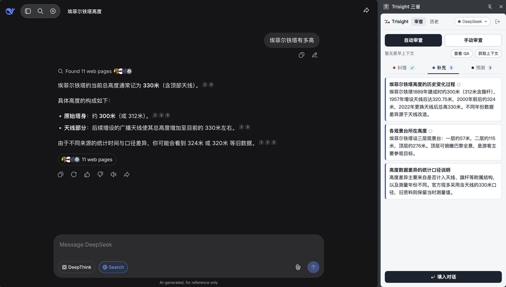
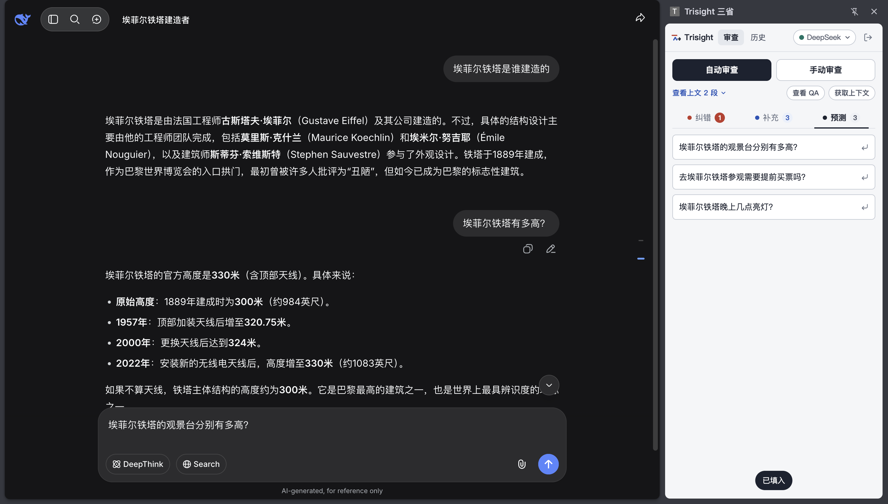
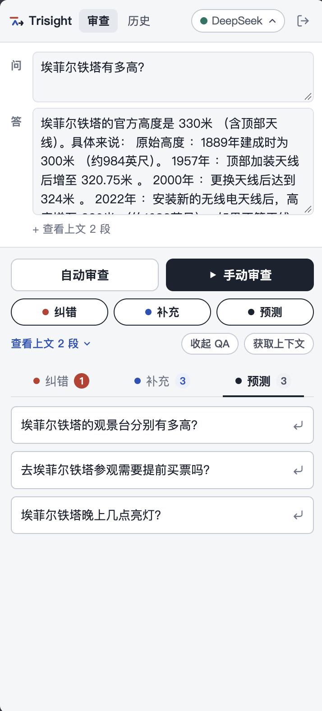
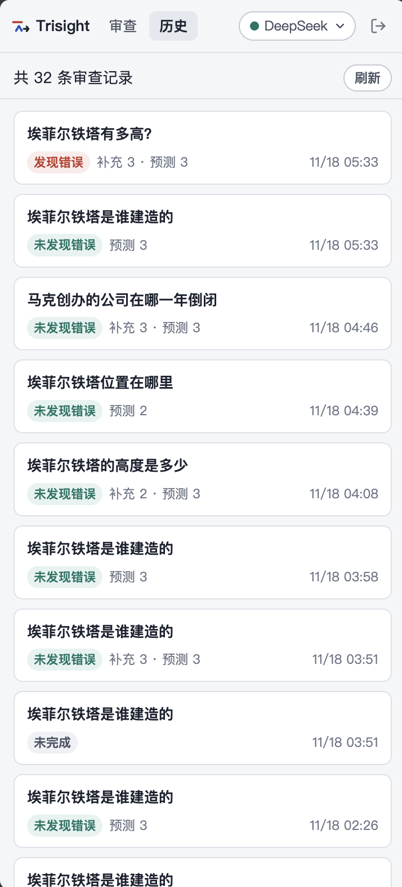
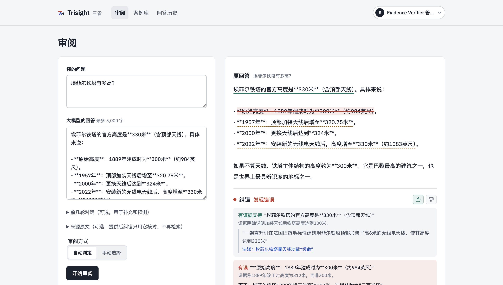
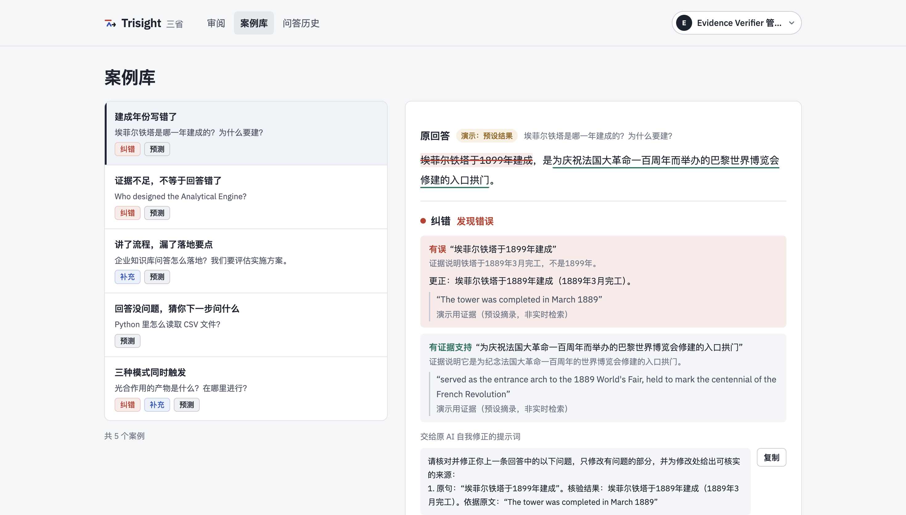

<div align="center">

# Trisight 三省 · Evidence Verifier

**大模型回答的外置审阅者（纠错 · 补充 · 预测）与可信多 Agent 事实核验架构**

[](LICENSE)
[](app/README.md)
[](https://evidence-verifier.edgeone.dev/)
[](app/extension/README.md)
[](docs/ev2-architecture.md)

[在线工作台](https://evidence-verifier.edgeone.dev/) · [下载浏览器插件 v0.6.6](https://evidence-verifier.edgeone.dev/downloads/evidence-verifier-extension.zip) · [核心能力](#2-核心能力与展示) · [Chrome 伴随插件](#3-chrome-伴随插件v066) · [EV 2.0 多 Agent 架构](docs/ev2-architecture.md) · [快速开始](#6-快速开始)

</div>

---

**Trisight 三省（Evidence Verifier）** 是一个面向 AI 对话与长文输出的外置事实审查与阅读辅助系统：当大语言模型给出回答后，三省不替换主模型，而是在旁侧同步完成**原子事实拆解、独立证据取证、冲突核验、最小粒度修订、完整性补充与下一问预测**，并以 **Chrome 侧边栏伴随插件**、**Web 审阅工作台** 和 **Python/HTTP 验证内核** 三种形态交付。

<p align="center">
  <a href="https://evidence-verifier.edgeone.dev/">
    
  </a>
</p>

> [!TIP]
> **直接体验在线版本**：访问 **[https://evidence-verifier.edgeone.dev/](https://evidence-verifier.edgeone.dev/)** 可直接使用三省工作台、预设案例库与历史审查记录；安装 Chrome 伴随插件后，可在 **DeepSeek / ChatGPT / Claude / Gemini** 对话页面右侧实时同步审查。

> [!NOTE]
> **开源仓库范围说明**：本仓库公开 Web 工作台、Chrome MV3 伴随插件（`v0.6.6`）、EdgeOne 部署与基础版 Python EV 核验内核。**Evidence Verifier 2.0 的多 Agent 运行时、评测管线与策略训练已实现，因涉及保密暂不开源，实验结果将随论文发布**；架构与机制见 [Evidence Verifier 2.0 架构说明](docs/ev2-architecture.md)。

---

## 1. 为什么做三省（Trisight）？

主流对话模型已经很擅长流畅作答，但在严肃检索、决策辅助与专业知识场景中仍有三个痛点：

1. **细节幻觉难察觉**：回答看似通顺，但年份、数据、人物归属或因果限定往往悄悄偏移（例如“埃菲尔铁塔 1889 年建成时高 300 米”）。
2. **局部错误与完整覆盖割裂**：常规纠错模型容易“顺手重写整段话”从而引入新幻觉，或者只挑错字却漏掉用户真正关心的前提与关键视角。
3. **跨平台核对与审计缺失**：缺乏留在对话旁侧的外置审阅层，也缺乏可追溯到原文位置、版本修订与证据缺口的严格确定性门禁。

三省把审查过程做成**零侵入的外置伴随体验**与**严格证据约束的可信闭环**——前端像侧栏助手一样紧贴对话流即时反馈，底层通过协议隔离、盲抽取证与确定性状态控制防止模型“自审自批”。

---

## 2. 核心能力与展示

三省围绕结构化审阅管道提供三类输出，并用统一视觉语义标注在原文与卡片中：

| 能力 | 颜色与标识 | 核心作用 |
| --- | --- | --- |
| **纠错（Correct）** | 红色删除线 / 纠错卡片 | 拆解关键事实断言并联网检索核对；**只有被检索到的原文明确反驳的断言才标红**，附更正、原文引文与来源链接；其余断言显示为绿色卡片，其中有证据支持的附原文引文，未能核实的不附引文 |
| **补充（Supplement）** | 蓝色补充要点 / 引用卡片 | 基于覆盖缺口分析提取原回答遗漏的必要背景、边界条件与延伸来源；允许在回答已完整时返回「无需补充」，严禁为凑篇幅强行扩写 |
| **预测（Predict）** | 黑色追问建议与一键填入 | 基于已核验可信事实生成下一步高价值、无虚假事实前提的追问；在支持的 AI 对话页可**一键填入输入框**继续追问 |

### 2.1 纠错：在对话页实时逐条取证与修正（DeepSeek / ChatGPT）

插件自动识别当前对话的最新一轮问答（`自动审查`），抽取关键断言并展示每条结论的核验结果、原文片段与来源；有误条目以红色高亮给出修正建议，其余断言显示为绿色卡片（有证据支持的附原文引文，未能核实的不附引文），并支持一键展开 `查看上文` 确认上下文摘要：

<p align="center">
  
</p>

### 2.2 补充：补足遗漏细节、层级数据与统计口径说明

切换至 `补充` 后，三省基于覆盖缺口分析提炼出原回答遗漏的历史演进、结构细节与口径差异（例如不同年份是否计入天线与旗杆的高度口径），并在回答已完整时克制输出、不强行扩写；同时支持一键 `↩ 填入对话` 将补充要点发回原对话继续深挖：

<p align="center">
  
</p>

### 2.3 预测：直接预测下一问并一键回填输入框

切换至 `预测` 后，三省基于已核验事实与检索上下文生成下一步高价值追问，点击即可直接写入页面输入框（例如 `已填入` DeepSeek 输入框），减少手动拼接提示词的摩擦：

<p align="center">
  
</p>

---

## 3. Chrome 伴随插件（v0.6.6）

Chrome MV3 侧边栏插件（[`app/extension/`](app/extension/README.md)）将审查能力直接嵌入日常 AI 对话工作流：

- **自动 / 手动双模式**：开启 `自动审查` 后，在模型输出完成时自动捕获本轮 Q&A 发起审查；也可随时切换为 `手动审查` 自由勾选 `纠错` / `补充` / `预测` 组合。
- **QA 与上下文按需透视**：工作区默认隐藏冗长原文，点击 `查看 QA` 可展开本次自动提取的完整 `问` / `答` 文本便于校验抓取准确度；点击 `获取上下文` / `查看上文` 可抓取并查看当前对话前序历史片段。
- **内置审查与历史双视图**：顶栏提供 `审查 ｜ 历史` 切换（对齐 Web 端右侧抽屉体验），可随时查阅过往审查条目，按「发现错误 / 未发现错误」标签快速回溯原文核验结论。
- **多站点适配器架构**：内置 `DeepSeek`（`chat.deepseek.com`）、`ChatGPT`（`chatgpt.com`）、`Claude`（`claude.ai`）、`Gemini`（`gemini.google.com`）页面提取器与统一规范化模块（注：DeepSeek 与 ChatGPT 已完成实网端到端验证，Claude / Gemini 为结构化适配器实现）。

<table>
  <tr>
    <td width="50%" align="center">
      <br>
      <sub><b>审查视图</b>：可随时展开 <code>查看 QA</code> 核对提取内容，并自由切换 <code>自动/手动审查</code> 与三项能力开关</sub>
    </td>
    <td width="50%" align="center">
      <br>
      <sub><b>历史视图</b>：顶栏切换至 <code>历史</code>，集中查看历次审查记录与「发现错误 / 未发现错误」状态标签</sub>
    </td>
  </tr>
</table>

详细安装与使用步骤见 [6.2 使用插件](#62-使用插件) 与 [插件说明文档](app/extension/README.md)。

---

## 4. Web 审阅工作台（Trisight Web）

对于长篇文本、无插件浏览器或团队演示场景，可通过 Web 工作台（`/assist.html`、`/library.html`、`/history.html`）完成完整审阅闭环：

<table>
  <tr>
    <td width="50%" align="center">
      <br>
      <sub><b>四阶段透明进度</b>：<code>判断与初审 → 检索原文 → 逐条核验 → 修订回答</code> 逐步推进并实时显示当前阶段</sub>
    </td>
    <td width="50%" align="center">
      <br>
      <sub><b>批注原文与证据报告</b>：左侧查看带行内批注的原文，右侧对照红色纠错、绿色已证实与蓝色补充卡片</sub>
    </td>
  </tr>
  <tr>
    <td width="50%" align="center">
      <br>
      <sub><b>预设案例库（<code>/library.html</code>）</b>：内置多组经典幻觉、历史年份、科学数据与时效变化演示案例，点击即看完整批注结果</sub>
    </td>
    <td width="50%" align="center">
      <br>
      <sub><b>历史记录（<code>/history.html</code>）</b>：沉淀个人或工作区提交过的全部问答审查与修正结果，支持按条回看明细</sub>
    </td>
  </tr>
</table>

---

## 5. 系统架构与 Evidence Verifier 2.0

Evidence Verifier 2.0 采用 **「1 个监督规划 Agent + 5 个核心专业 Agent + 3 个确定性基础设施」** 的分层受控闭环架构：Supervisor 只提出动作，由确定性 Runtime 校验合法性、管理不可变版本与状态，最终由不调用 LLM 的 Quality Gate 判定能否发布。

<p align="center">
  
</p>

五项核心机制：Draft → Record → ReleaseCandidate 的所有权隔离与不可变版本；Verification 内部的双阶段盲抽与证据位置诊断；按证据位置的动态恢复与修订后重新核验；必经的完整性分析与新增事实复核；Supervisor 的 SFT → GRPO 序列决策优化。2.0 运行时、评测管线与策略训练已实现但暂不开源，实验结果将随论文发布。角色边界与机制细节见 **[Evidence Verifier 2.0 架构说明](docs/ev2-architecture.md)**。

### 5.1 仓库目录导航（当前公开代码模块）

| 目录 / 模块 | 定位与职责 | 核心文档 / 入口 |
| --- | --- | --- |
| `app/` | 本地研究版服务（Python 标准库 HTTP 服务）、静态前端（首页 / 审阅 / 案例库 / 历史 / 账号）与基础 EV 核验、原文定位、关系判定与补搜修复引擎 | [`app/README.md`](app/README.md)、[`app/engine.py`](app/engine.py)、[`app/grounding.py`](app/grounding.py)、[`app/relations.py`](app/relations.py)、[`app/repair.py`](app/repair.py) |
| `app/extension/` | Chrome MV3 侧边栏伴随插件（自动抓包、QA/上下文查看、审查/历史切换、预测一键填入） | [`app/extension/README.md`](app/extension/README.md) |
| `api_edition/` | 基于 OpenAI-compatible 模型接口与向量检索的线上验证版本与评测脚本 | [`api_edition/README.md`](api_edition/README.md) |
| `sdk/` | 轻量 Python SDK 与公共校验入口 | [`sdk/README.md`](sdk/README.md) |
| `cloud_runtime/` & `deploy/edgeone/` | 线上审阅接口（纠错 / 补充 / 预测分步任务、账号、预算）与 EdgeOne Pages 部署配置 | [`docs/edgeone-deployment.md`](docs/edgeone-deployment.md) |
| `scripts/` | 链路检查（`check_doc_links.py`）、隐私与发布门禁（`check_publication.py`）、诊断复现与 EdgeOne 打包脚本 | [`scripts/check_publication.py`](scripts/check_publication.py) |
| `docs/` | 产品方案、前后端集成、后训练（SFT/DPO）与历史验证报告 | [`docs/trisight-assist.md`](docs/trisight-assist.md) |

---

## 6. 快速开始

### 6.0 线上体验或启动本地服务

- **方式 A（最快）：直接访问在线版**
  打开 **[https://evidence-verifier.edgeone.dev/](https://evidence-verifier.edgeone.dev/)**，即可使用工作台、案例库与 API。
- **方式 B：本地启动研究版（只需 Python 3.11+ 标准库）**

```bash
python3 app/server.py --port 8790
```

启动后访问 `http://127.0.0.1:8790`。本地研究版用于回放诊断与离线 EV 核验，不运行纠错 / 补充 / 预测三种模式（相关接口返回 `501 cloud_only`）；三种模式运行在云端，自行部署见 [`docs/edgeone-deployment.md`](docs/edgeone-deployment.md)。

### 6.1 调用审阅接口（`/api/assist`）

审阅接口需要受邀账号。登录后，用返回的会话令牌创建任务，再反复调用 `advance_path` 推进，直到 `state` 为 `completed`；每次推进最多产生一次模型或检索调用：

```bash
BASE=https://evidence-verifier.edgeone.dev
TOKEN=$(curl -s -X POST $BASE/api/auth/login -H 'Content-Type: application/json' \
  -d '{"identifier":"<用户名>","password":"<密码>"}' | python3 -c 'import sys,json;print(json.load(sys.stdin)["session_token"])')

curl -s -X POST $BASE/api/assist \
  -H "Authorization: Bearer $TOKEN" -H 'Content-Type: application/json' \
  -d '{
    "question": "埃菲尔铁塔什么时候建成的，刚建成时有多高？",
    "answer": "埃菲尔铁塔于 1889 年建成，刚建成时高 300 米，是当时世界最高建筑。",
    "modes": ["correct", "supplement", "predict"],
    "compose": false
  }'
# 返回 {"id": ..., "state": "queued", "advance_path": "/api/assist/<id>/advance", ...}
curl -s -X POST $BASE/api/assist/<id>/advance -H "Authorization: Bearer $TOKEN"
```

字段、限制与结果格式见 [Trisight 审阅接口](docs/trisight-assist.md)；本地研究版的离线核验接口（`/api/verifications` 等）见 [`docs/integration.md`](docs/integration.md)。

### 6.2 使用插件

1. **下载安装包**
   - 直接下载最新打包 ZIP：**[`evidence-verifier-extension.zip`](https://evidence-verifier.edgeone.dev/downloads/evidence-verifier-extension.zip)**（仓库同步路径：[`app/static/downloads/evidence-verifier-extension.zip`](app/static/downloads/evidence-verifier-extension.zip)），解压到本地文件夹；也可以用 `python3 app/scripts/build_extension.py --out <路径>.zip` 从源码自行打包（`app/extension/` 目录本身不含侧栏页面，不能直接加载）。
2. **加载到 Chrome / Chromium 浏览器**
   - 打开 `chrome://extensions`，开启右上角 **开发者模式（Developer mode）**。
   - 点击 **加载已解压的扩展程序（Load unpacked）**，选择解压后的插件目录。
3. **打开任意 AI 对话页并开始伴随审查**
   - 访问 [DeepSeek](https://chat.deepseek.com/)、[ChatGPT](https://chatgpt.com/)、[Claude](https://claude.ai/) 或 [Gemini](https://gemini.google.com/)，点击浏览器右上角扩展图标打开 Trisight 侧边栏。
   - 插件只连接在线服务 `https://evidence-verifier.edgeone.dev`，首次使用需用受邀账号登录。
   - 在顶部可切换 **审查**（查看 `查看 QA`、`获取上下文`、`自动/手动审查` 与 `纠错/补充/预测`）或 **历史**（回看历次审查记录）；点击预测结果旁的填入按钮可直接将追问写入聊天输入框。

更多细节见 [`docs/conversation-sidecar.md`](docs/conversation-sidecar.md) 与 [`app/extension/README.md`](app/extension/README.md)。

### 6.3 运行测试与质量检查

```bash
# 1. Chrome 扩展单测（适配器、历史存储、上下文提取与渲染逻辑）
node --test app/tests/extension/*.test.cjs

# 2. 服务端核心、API 与脚本测试
python -m unittest discover -s app/tests -p 'test_*.py'
python -m unittest discover -s api_edition/tests -p 'test_*.py'
python -m unittest discover -s scripts/tests -p 'test_*.py'

# 3. 文档链接完整性 & 仓库公开合规门禁
python scripts/check_doc_links.py
python scripts/check_publication.py
```

---

## 7. 支持矩阵与交付状态

| 模块 / 能力 | 状态 | 说明与验证依据 |
| --- | --- | --- |
| 在线工作台（首页 / 审阅 / 案例库 / 历史） | **已上线** | 已部署至 EdgeOne（`evidence-verifier.edgeone.dev`），支持分阶段进度与批注视图 |
| Chrome 扩展核心 + 历史视图 + `查看 QA` + `获取上下文` | **已实现并测试** | `node --test app/tests/extension/*.test.cjs` 覆盖页面抓取、历史归档与纠错筛选 |
| DeepSeek / ChatGPT 网页端自动抓取与实网审查 | **已实网验证** | 已完成 `chat.deepseek.com` 与 `chatgpt.com` 对话页捕获、核验与回填验证 |
| Claude / Gemini 网页端适配器 | **代码已接入** | 已实现站点提取器与测试覆盖；跨站真实页面定期回归待持续补充 |
| EdgeOne Serverless 代理部署 | **已上线** | 见 [`docs/edgeone-deployment.md`](docs/edgeone-deployment.md) |
| 离线 Python EV 微核（Grounding / Relations / Repair） | **已验证** | `app/tests` 与公开评测文档见 [`docs/evaluation.md`](docs/evaluation.md) |
| EV 2.0 多 Agent 运行时、评测管线与策略训练（P0–P7） | **已实现，暂不开源** | 架构与机制见 [EV 2.0 架构说明](docs/ev2-architecture.md)；实验结果将随论文发布 |

---

## 8. 工程文档与研发路线

- **产品与架构设计**：[`docs/ev2-architecture.md`](docs/ev2-architecture.md) · [`docs/trisight-assist.md`](docs/trisight-assist.md) · [`docs/conversation-sidecar.md`](docs/conversation-sidecar.md) · [`docs/product-workbench.md`](docs/product-workbench.md)
- **部署与集成指南**：[`docs/edgeone-deployment.md`](docs/edgeone-deployment.md) · [`docs/integration.md`](docs/integration.md) · [`api_edition/README.md`](api_edition/README.md) · [`sdk/README.md`](sdk/README.md)
- **评测、数据与训练研究**：[`docs/evaluation.md`](docs/evaluation.md) · [`docs/data.md`](docs/data.md) · [`docs/post-training.md`](docs/post-training.md)
- **版本记录与交付**：[`CHANGELOG.md`](CHANGELOG.md) · [`docs/roadmap.md`](docs/roadmap.md) · [`docs/delivery.md`](docs/delivery.md)

---

## 9. 开源许可与第三方致谢

- 公开代码遵循 [`LICENSE`](LICENSE)（MIT License）。
- 随仓库分发的字体与第三方组件许可清单见 [`THIRD_PARTY_NOTICES.md`](THIRD_PARTY_NOTICES.md) 与 [`app/static/fonts/LICENSE.txt`](app/static/fonts/LICENSE.txt)。
