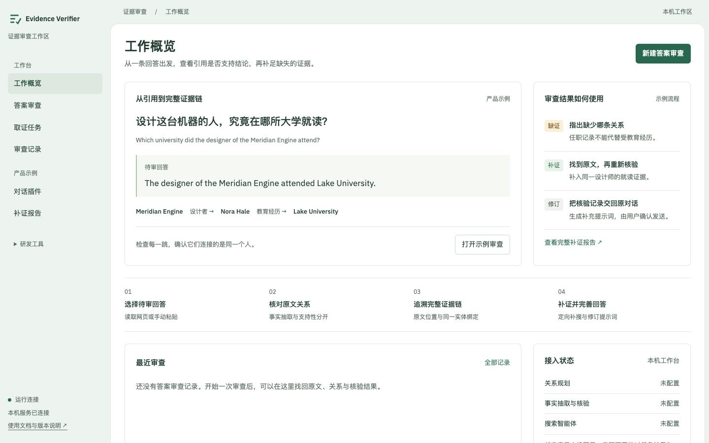
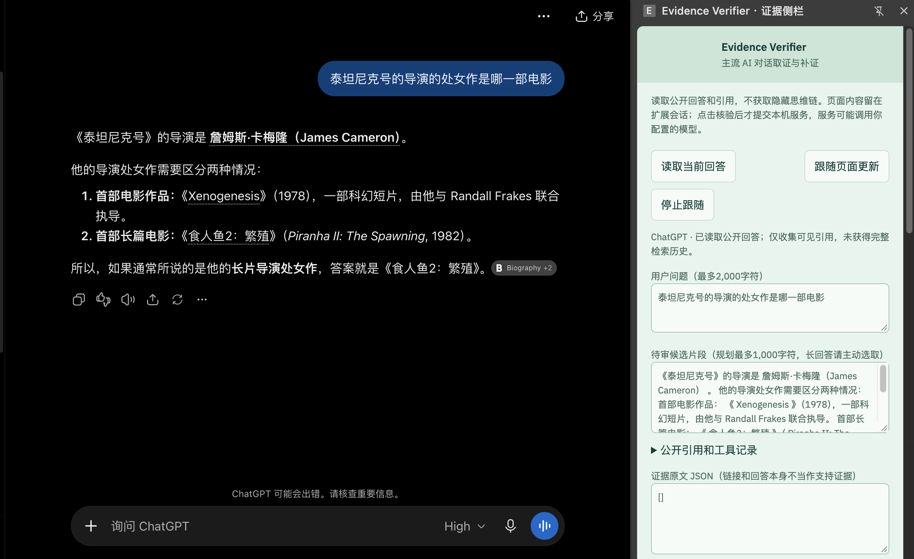
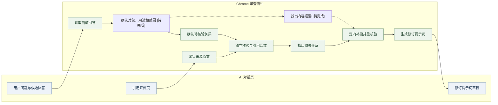
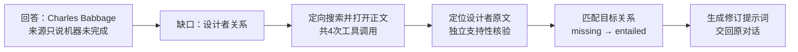
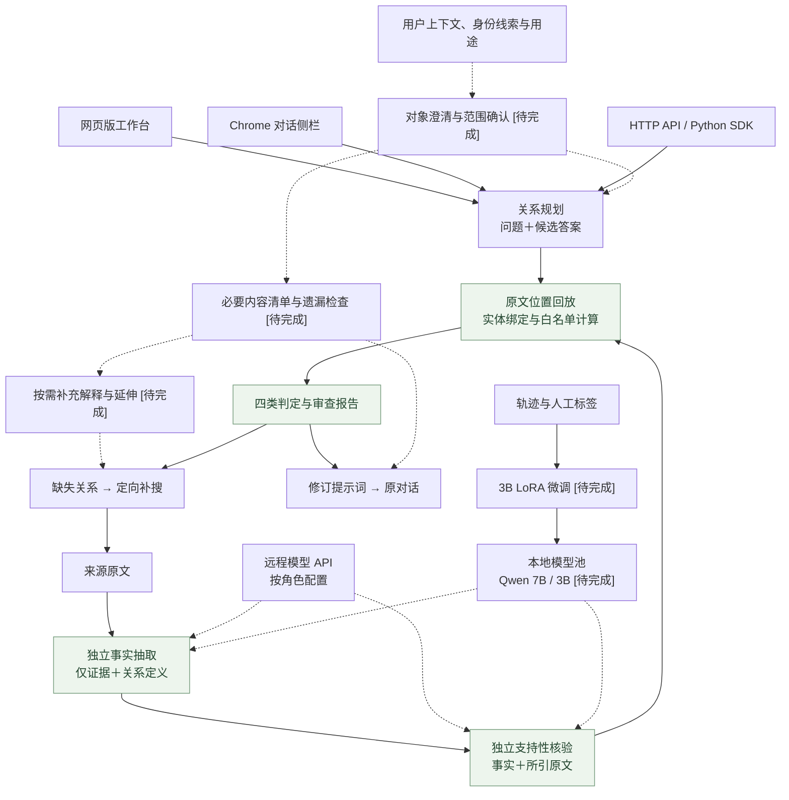

<div align="center">

# Evidence Verifier

**让回答对准问题，让结论有据可查。**

面向 AI 对话与搜索智能体的证据核验与回答完善系统。<br>
核对原文、找出证据缺口，把补充依据交回原对话；对象澄清、内容覆盖和按需延伸沿同一流程接入。[待完成]

[](https://github.com/Gump111458785/evidence-verifier/actions/workflows/release-checks.yml)
[](api_edition/README.md)
[](LICENSE)
[](api_edition/README.md)

[网页版与插件版](#2-网页版与插件版) · [补证案例](#3-补证案例) · [系统架构](#4-系统架构) · [核心机制](#5-核心机制) · [后训练](#6-后训练证据核验模型的任务适配) · [快速开始](#7-快速开始)

</div>

## 1. 解决什么问题

AI 的回答可能每句话都像是对的，却没有回答用户真正想问的事：同名人物认错了，复杂概念只解释了一部分，或关键结论附了引用却没有得到证明。

Evidence Verifier 围绕三件事展开：**对象是否找对、问题是否答全、结论是否有据。** 证据核验逐条检查原文与关系；同名对象澄清、复杂问题覆盖检查及按需延伸纳入后续产品能力。[待完成]

| 用户遇到的问题 | 处理方式 | 用户得到什么 |
|---|---|---|
| **回答了另一个同名人物**：姓名相同，职业、机构或年代不同 | 结合上下文核对身份线索；无法确定时列出候选，先请用户确认，不自行猜测 [待完成] | 确认过的查询对象，减少围绕错误人物继续回答 |
| **大问题只回答了一部分**：解释了概念，却漏掉用户关心的应用条件或限制 | 根据问题与用途列出必要子问题，对照回答找遗漏，再围绕缺口补搜 [待完成] | 有依据的内容覆盖清单与补充回答 |
| **回答停在表面，缺少进一步解释**：用户需要比较、例子或延伸背景 | 区分必要内容和可选延伸，让用户选择方向、深度与搜索预算 [待完成] | 与需求相关的展开内容，避免为凑篇幅无边界扩写 |
| **引用相关，却没有证明结论** | 事实抽取与支持性核验分开，逐条核对引用 | 关系结论、原文位置与判断依据 |
| **两条事实成立，却接到了不同的人** | 全链变量绑定，检查主体、客体、方向与时间 | 完整证据链或明确的断点 |
| **发现缺证，却不知道接下来搜什么** | 将缺失关系转成查询，在共享预算内补搜 | 新来源、重核验结果与修订提示词 |

“答全”以用户问题和确认的用途为准。用户只想要简短定义时，不强制扩展成综述；身份不明时，补搜也不能替用户决定他原本想问谁。

### 1.1 一次审查应该交付什么

报告分别呈现三类结果：**查询对象**是否确认、**必要内容**是否覆盖、**关键结论**是否有证据。三者不合并为一个模糊的“可信度分数”：证据充分不能替代对象确认，文字变长也不能替代内容完整。[待完成]

处理顺序为“确认对象与用途 → 约定需要回答的内容 → 核对现有回答 → 围绕缺口补充 → 用户审阅”。身份线索冲突时先澄清；只需补例子时不重复整篇搜索。系统提出覆盖清单供确认，不声称自动穷尽任何大概念。[待完成]

## 2. 网页版与插件版

| | **网页版 · 答案审查工作台** | **插件版 · 对话中的审查助手** |
|---|---|---|
| 使用位置 | 独立浏览器页面 | Chrome 侧栏，与 AI 对话并排 |
| 输入方式 | 粘贴问题、回答片段及来源原文 | 主动读取当前回答，采集用户打开的引用来源 |
| 操作重点 | 创建审查、管理取证任务、查看历史报告 | 核对当前回答、补搜缺口、将提示词填回草稿 |
| 报告内容 | 原文、逐关系结论、引用位置、变量绑定、补搜轨迹 | 当前对话的关系链、证据缺口与修订建议 |
| 回答完善 | 在报告中加入对象确认、必要内容清单与可选延伸 [待完成] | 先澄清对象或用途，再生成针对遗漏项的修订提示词 [待完成] |
| 接入方式 | HTTP API、Python SDK | Chrome MV3 扩展，连接本机核验服务 |

### 2.1 网页版：集中查看答案、证据与报告



工作台按“工作概览 → 答案审查 → 取证任务 → 审查记录”组织。审查报告分别保留初始核验与补搜结果，支持刷新恢复、原文回放和 JSON 导出。

### 2.2 插件版：沿着当前对话完成核验与补证



左侧为ChatGPT原对话，右侧为Evidence Verifier审查侧栏。截图展示“读取当前回答”后的问题与候选片段预览；用户可继续采集来源原文、确认待核验关系，并生成补充提示词。



插件读取页面可见回答与引用，不读取隐藏思维链。用户确认后才提交核验；提示词只填入空白草稿，由用户发送，不覆盖已有内容。

| 对话平台 | 交互范围 |
|---|---|
| ChatGPT | 单案例覆盖回答读取、来源采集、关系规划、核验、提示词及草稿写入 |
| Gemini | 对话读取、引用采集与草稿写入的实机兼容 [待完成] |
| Claude | 对话读取、引用采集与草稿写入的实机兼容 [待完成] |

[插件操作说明](docs/conversation-sidecar.md) · [工作台使用说明](docs/product-workbench.md)

## 3. 补证案例

### 3.1 谁设计了 Analytical Engine？引用没有回答“谁”

用户在 AI 对话中提问：**“Who designed the Analytical Engine?”** AI 给出候选答案 **Charles Babbage**。审查时先输入一句来源原文：

> The Analytical Engine was never completed.

这句话只说明机器没有完成，不能证明设计者。核验器因此指出缺失关系：

```text
Analytical Engine ── designed_by ──> Charles Babbage
                         ↑
                  当前原文没有支持
```

系统围绕设计者关系补搜，执行 **1 次 search、3 次 open**，从返回的网页正文定位到：

> Charles Babbage commenced work on the design of the Analytical Engine in 1834.

抽取器在不读取问题、候选答案和目标关系的条件下取得事实；支持性核验器检查引用是否真正支持设计关系，程序再回放字符位置、匹配主体与客体。该轮目标关系由 `missing` 变为 `entailed`，生成包含新证据与核验记录的补充提示词。



同批事实中，“Babbage 在 Cambridge 学习”获得支持，“Babbage 在 Cambridge 受雇”仍为缺失；错误设计者、主客体互换、学会会员推雇佣三个目标也没有被放行。引用相关，不等于关系成立。

本例使用 DeepSeek Flash 与真实搜索 API，输入为受控缺证材料；它说明一次关系补证的具体过程，不代表问答准确率提升。后续续测出现的空抽取与无效输出连同成功记录一并保留。[原始案例与费用](docs/web-grounding-validation-2026-11-02.md) · [续测记录](docs/product-workbench.md#本轮真实api续测与边界)。

### 3.2 同名人物：答案有依据，但对象不是用户想问的人

例如，用户问“张伟主要研究什么？”，上下文指的是某所大学的研究者，AI却介绍了一位同名从业者。即使回答引用的资料都属实，仍然答错了对象。

处理路径是先核对学校、职业、研究领域和时间等身份线索。线索不足时，给出候选人物，请用户补充机构或确认对象；确认后再检索、核验，并在报告中保留身份依据。无法分辨时，明确保留歧义。[待完成]

这与跨段事实绑定是两个环节：身份澄清决定“用户要问谁”，关系绑定检查“引用里的经历是否属于同一个人”。两者都要检查，不能用姓名相同直接连通证据链。

### 3.3 复杂概念：讲了基本流程，却漏掉影响使用的细节

例如，用户希望了解“企业知识库问答怎么落地”，回答只介绍文档检索和答案生成。若用户的用途是评估实施方案，还需要了解权限如何处理、资料怎样更新、引用怎样回溯，以及效果和成本怎么衡量。

系统先按这个用途整理需要回答的子问题，再标出哪些已回答、哪些缺少解释、哪些缺少证据。补搜只围绕遗漏项进行，新增内容同样经过原文核验；用户确认后形成补充提示词，交回原AI完善回答。[待完成]

如果用户还想比较不同方案或看具体例子，这些作为可选延伸，先确认再展开。内容更长不自动算更好；验收要看必要问题是否答到、补充内容是否相关，以及是否有证据支持。[待完成]

## 4. 系统架构



问题、候选答案与用户上下文用于对象澄清及规划；抽取器和支持性核验器仍只接收各自核验所需的证据输入。各角色可配置不同模型，纯 API 路径无需本地 GPU。

## 5. 核心机制

| 组件 | 做法 | 实现与说明 |
|---|---|---|
| 对象澄清 | 根据上下文核对身份；存在多个合理候选时先确认，不凭姓名猜测 [待完成] | [产品验收计划](docs/roadmap.md#痛点驱动的产品验收) |
| 内容覆盖与按需延伸 | 先确认必答内容，再检查遗漏；例子、对比和背景作为可选项 [待完成] | [产品验收计划](docs/roadmap.md#痛点驱动的产品验收) |
| 候选不可见抽取 | 抽取器只看证据和12类关系定义，避免围绕候选答案挑事实 | [engine.py](app/engine.py) |
| 引用内独立核验 | 逐事实核对引用是否支持关系、角色与时间，实体命中不替代语义判断 | [grounding.py](app/grounding.py) |
| 跨关系变量绑定 | 必要关系必须连接同一实体；年份加减与日期区间使用白名单计算 | [relations.py](app/relations.py) |
| 有界引用补齐 | 显式启用同文档前后各2句、额外最多600字符的补齐；保留中间句，最多一次模型定位修正 | [配置说明](api_edition/README.md) |
| 缺口驱动补搜 | search/open/find 共用工具预算，保存原文、来源、范围及重核验轨迹 | [repair.py](app/repair.py) |
| 缓存与请求合并 | 按模型版本、证据、提示词与 schema 隔离缓存，合并相同并发请求 | [inference.py](app/inference.py) |

结果区分 `entailed / missing / contradicted / ambiguous`。格式错误、引用定位失败、不支持的关系与运行失败单列，不计作缺证。

身份与内容覆盖在关系核验之前处理：先确认对象与需要回答的子问题，再把可核对的事实交给证据链。开放概念中不属于当前关系类型的内容，单独标记覆盖范围，不因无法结构化就当作已经检查。[待完成]

## 6. 后训练：证据核验模型的任务适配

### 6.1 训练目标与适用范围

后训练围绕**事实抽取与证据支持性判断**开展，重点降低关系误推、角色混淆、同名实体错接和时间限定错误。目标是在减少错误放行的同时保持支持正例召回，并验证改进能否转化为同预算搜索任务的回答质量提升。[待完成]

对象澄清、必要内容覆盖与按需延伸属于规划和交互环节，先使用固定规划模型验证流程；用户意图不进入独立抽取与核验输入。规划模型是否追加训练，依据单独的任务评测决定。[待完成]

### 6.2 模型与任务分工

| 模型 / 训练产物 | 任务与输入边界 |
|---|---|
| **Qwen2.5-3B-Instruct / 抽取LoRA** | 仅接收原文和关系定义，输出主体、关系、客体、极性、时间限定及引用ID；覆盖原文中符合关系定义的事实，不围绕候选答案选择证据 [待完成] |
| **Qwen2.5-3B-Instruct / 核验LoRA** | 接收单条事实及其实际引用，输出支持、缺失、矛盾或歧义及判断依据；不接收原问题、候选答案和目标关系 [待完成] |
| **Qwen2.5-7B-Instruct** | 承担规划、搜索与回答，首轮保持权重冻结，作为系统端固定对照 |
| **Qwen2.5-14B-Instruct** | 用于候选标注与直接裁判对照，候选标签经程序检查及人工审核后使用 |

两个3B任务分别从相同底座训练，保存为独立adapter，支持单模块替换和组合评估。跨关系变量绑定、字符位置回放与白名单计算继续由程序执行，模型训练不替代规则校验。[待完成]

### 6.3 训练数据与质量控制

基于 **MuSiQue、HotpotQA** 训练材料及智能体错误轨迹构建约 **5,000条监督记录**，分别统计原文级抽取样本和逐事实核验样本。[待完成]

| 数据组成 | 构建与标注要求 |
|---|---|
| 支持事实正例，约40% | 将数据集支持段落转为原子事实，补齐角色、时间及引用；问题级支持段落不直接等同于逐关系标签 [待完成] |
| 真实错误轨迹，约30% | 收集漏抽、错绑、关系误推和无效输出，经复核形成纠正目标，不将失败输出直接作为训练答案 [待完成] |
| 合成困难负例，约30% | 构造角色互换、任职/教育替换、区域/省份替换、删证及干扰实体；缺证与明确矛盾分别标注 [待完成] |

先按问题、来源文档和变体家族划分训练与验证集合，再生成扩增样本；2Wiki保留用于分布外评测。14B候选标注通过原文定位与格式检查后，人工抽检10%，争议样本双人复核并报告一致性。抽取样本同时保留合法空输出与充分支持正例，控制过度拒绝倾向。[待完成]

身份选择、必要子问题和延伸偏好单独建立规划评测标签：身份以用户确认结果为准，内容范围由人工按用途复核，不以模型自行生成的清单作为评测标准。[待完成]

### 6.4 微调方法与训练配置

采用 **Transformers + PEFT 的LoRA监督微调（SFT）**，冻结底座参数，仅更新任务adapter。按训练前检查、小规模试训、正式训练与独立验收依次推进；配置选择只使用验证集，最终测试集不参与调参。[待完成]

| 配置项 | 首轮方案 |
|---|---|
| 训练精度与LoRA | bf16；作用于`q_proj/v_proj`，`rank=16`、`alpha=32`、`dropout=0`；另设全线性层及`rank=32`对照 [待完成] |
| 优化与批次 | AdamW，初始学习率`2e-4`，micro-batch=1，梯度累积8；单卡有效batch=8。比较`1e-4/2e-4`学习率与1–3轮训练 [待完成] |
| 序列与监督 | 初始长度2,048 tokens，仅计算模型输出部分的损失；检查消息模板与监督边界，超长样本按完整证据窗口处理，不静默截断 [待完成] |
| 显存控制 | 梯度检查点、长度分桶及128-token分块投影/交叉熵；与标准损失对照数值、梯度、峰值显存及耗时 [待完成] |
| 资源安排 | 使用3×RTX 5090资源池，首轮按单卡顺序训练3B；按空闲资源安排评测，不默认多卡并行或14B与训练同时驻留 [待完成] |
| 选优与复现 | 验证集选择训练轮数和配置，采用3个固定随机种子，记录模型、数据、代码和配置版本 [待完成] |

[训练入口](app/training.py)与[损失实现](app/torch_training.py)提供基础LoRA训练及分块损失路径。现有配置中的20步用于流程检查；正式轮数、定期checkpoint、恢复和验证集选优纳入实验入口。[待完成]

### 6.5 验证设计与验收标准

验收区分训练执行正确性、模块效果、分布外表现和系统收益。训练损失下降不作为模型发布的充分条件。[待完成]

| 验证层级 | 数据、对照与验收要求 |
|---|---|
| 工程正确性 | 检查梯度与loss有限、adapter参数实际更新、底座保持冻结，以及保存重载一致性；分块损失与标准实现做数值和梯度对照 [待完成] |
| 开发回归 | 沿用80题门槛：联合正确≥72/80、正负各≥36/40、16个变量绑定例全对、无无效输出、关键负例零误放行；旧70题仅用于开发 [待完成] |
| 独立核验 | 600题人工双标，MuSiQue/HotpotQA/2Wiki各200；结论、引用、角色及绑定全部正确才计联合成功。报告错误放行率、支持召回、四类Macro-F1及关系覆盖率 [待完成] |
| 模块归因 | 对比原始3B、仅微调抽取、仅微调核验、双模块微调，并加入14B直接裁判；抽取报告事实Precision/Recall/F1，核验在固定事实输入下独立评分 [待完成] |
| 搜索收益 | 300题、相同6次工具调用预算，对比无核验、自由重搜、14B裁判与3B拆分核验；使用外部证据标准评估正确且证据充分的回答比例 [待完成] |
| 产品适配 | 独立评测确认后身份正确率、不必要澄清比例、必要内容覆盖和无关延伸比例，不归因于3B核验训练 [待完成] |

主要结果附95%置信区间，搜索任务采用配对检验。相较原始3B，联合正确率提升的区间下界应大于0，错误放行率不升；支持召回差值下界不低于−3个百分点，该值为预设验收容忍范围。无效输出计入失败并单报，不从分母中删除。[待完成]

补充对照覆盖输入屏蔽、困难负例、跨跳绑定与定向补搜，以区分训练、规则和额外检索的贡献。具体统计协议见[技术附录](docs/post-training.md)。[待完成]

### 6.6 预期成果与交付物

| 成果类别 | 主要指标 | 结果记录 |
|---|---|---|
| 证据模型效果 | 抽取事实F1、核验Macro-F1、联合正确率、错误放行率、支持召回 | 【原始3B】→【任务adapter】 [待完成] |
| 泛化与搜索收益 | 2Wiki联合正确率、同预算正确且证据充分的回答比例 | 【固定对照】→【系统结果】 [待完成] |
| 产品任务效果 | 确认后身份正确率、必要内容覆盖率、无关延伸及不必要澄清比例 | 【原始流程】→【完整流程】 [待完成] |
| 完整任务成功率 | 在确认范围内同时满足对象正确、必要内容覆盖与关键事实有据 | 【原始流程】→【完整流程】 [待完成] |
| 工程成本 | 峰值显存、单题GPU秒、P95延迟、工具调用与用户确认次数 | 【同负载基线】→【部署配置】 [待完成] |

交付两个独立adapter、底座与tokenizer版本、数据划分清单、训练配置、日志及评测报告。模型指标与产品指标分别记录，显存或成本收益以同负载测量为准。[待完成]

### 6.7 技术依据与实验记录

历史三模型对照保留552份输出。在80题构造诊断中，14B拆分核验的联合正确数为69题，直接核验为52题；正例识别与变量绑定仍有损失。这些记录用于机制分析，与3B后训练成果分开计量。[历史评测](docs/evaluation.md)

训练参数、数据划分、验收门槛与统计方法见[后训练技术附录](docs/post-training.md)。3B底座使用[Qwen Research License](https://huggingface.co/Qwen/Qwen2.5-3B-Instruct/blob/main/LICENSE)，商用发布按其授权安排。

## 7. 快速开始

Python 3.10+，SQLite 支持 FTS5。

```bash
git clone https://github.com/Gump111458785/evidence-verifier.git
cd evidence-verifier
```

### 7.1 启动网页版与核验服务

```bash
python3 -m venv .venv-api
source .venv-api/bin/activate
python -m pip install -r api_edition/requirements.txt
cp -n api_edition/config.deepseek.example.json api_edition/config.local.json
export EV_API_VERIFIER_KEY='填写自己的密钥'
python api_edition/run.py --config api_edition/config.local.json --check
python api_edition/run.py --config api_edition/config.local.json --port 8790
```

打开 **http://127.0.0.1:8790/#audit**，粘贴问题与回答片段，添加来源原文，确认关系后提交。`--check`只检查配置，不发付费请求；核验、规划及补搜按所配API计费。配置可为各角色指定不同的OpenAI兼容服务，密钥通过环境变量提供，不写入仓库。[API配置](api_edition/README.md)

### 7.2 使用插件

从 [Releases](https://github.com/Gump111458785/evidence-verifier/releases) 下载扩展包，或从源码构建：

```bash
python3 app/scripts/build_extension.py --out dist/evidence-verifier-extension.zip
```

1. 解压扩展包，在 Chrome 的 `chrome://extensions` 开启开发者模式，点击“加载已解压的扩展程序”，选择含 `manifest.json` 的目录。
2. 复制扩展ID，填入 `api_edition/config.local.json` 的 `extension_id`，重启核验服务。
3. 在 ChatGPT 对话页打开侧栏，点击“读取当前回答”。
4. 打开引用来源页，主动点击插件图标授权该页，再点“收集当前来源页的原文”。
5. 生成并确认待核验关系，点击“开始独立核验”；缺证时启动定向补搜。
6. 生成修订建议，填入原对话空白草稿，审阅后自行发送。

### 7.3 接入其他应用

HTTP API 提供审查提交、任务观察、取消、恢复与导出；Python SDK和LangGraph适配连接已有搜索流程。[HTTP合同](docs/integration.md) · [SDK](sdk) · LangGraph真实框架集成验收 [待完成]

## 8. 应用接入

| 场景 | 接入方式 |
|---|---|
| AI 对话审查 | Chrome侧栏读取可见回答，采集引用，反馈修订提示词 |
| 搜索智能体 | HTTP核验接口作为回答前检查，缺口驱动补搜 |
| 企业知识库 | 接入内部检索、权限与审查记录管理 [待完成] |
| 训练数据质检 | 逐关系审查候选轨迹，人工复核后筛选训练样本 [待完成] |
| 托管服务 | 多用户认证、租户隔离、网关与运行监控 [待完成] |

核验结论覆盖所声明关系与提供的来源，不自动证明整题完整性或来源客观真实。默认服务监听本机回环地址。

## 9. 文档与开发

| 入口 | 内容 |
|---|---|
| [工作台](docs/product-workbench.md) · [插件](docs/conversation-sidecar.md) | 操作路径、报告与隐私范围 |
| [纯API](api_edition/README.md) · [应用集成](docs/integration.md) | 模型、搜索、扩展ID与接口 |
| [网页补证](docs/web-grounding-validation-2026-11-02.md) · [浏览器记录](docs/browser-validation-2026-11-02.md) | 输入、来源、运行轨迹与费用 |
| [评测](docs/evaluation.md) · [数据](docs/data.md) | 模型对照、标签与指标定义 |
| [路线图](docs/roadmap.md) · [交付](docs/delivery.md) | 实验安排、版本与分发 |

自有代码采用 [MIT License](LICENSE)，IBM Plex 字体采用 [SIL OFL](app/static/fonts/LICENSE.txt)。模型、数据与上游代码遵循各自许可，见 [数据与上游署名](THIRD_PARTY_NOTICES.md)。反馈问题请提交 [Issues](https://github.com/Gump111458785/evidence-verifier/issues)，附上去除密钥及私人对话的日志。
