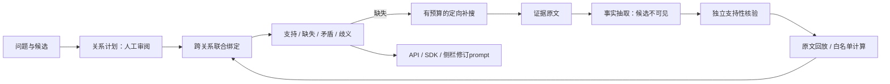

# Evidence Verifier

[](https://github.com/Gump111458785/evidence-verifier/actions/workflows/release-checks.yml) · Python 3.10+ · [MIT](LICENSE) · 无需 GPU 即可体验

**把 AI 回答的引用，变成可回放、可绑定、可补证的证据链。**

检查“引用是否真正支持这条关系”，识别角色误推和中间实体错绑；把证据缺口转成检索条件，再生成带证据记录的修订 prompt。愿景是让 AI 答案更容易被核查，当前核验范围是明确声明的关系。

[离线复算](#核心结果历史实测离线复算) · [选择运行模式](#快速开始) · [API 版](api_edition/README.md) · [侧栏](docs/conversation-sidecar.md) · [架构](docs/architecture.md) · [路线图](docs/roadmap.md) · [Releases](https://github.com/Gump111458785/evidence-verifier/releases)


图中是本机教学案例：事实与语义判定为预设，引用位置和联合绑定由程序执行。[初始错绑状态](docs/images/plugin-binding-gap.jpg)。

## 为什么需要它

“有引用”不等于“有证据”。工作地点不能推出受教育地点，同一区域不能推出同一省；两条关系分别成立，也可能连接了不同的人。

直接让 LLM 判断答案是否可靠，会把关系理解、事实抽取和支持性判断混在一起。本项目拆开这些步骤，让错误落到具体的关系、角色、原文位置或变量绑定上。

## 核心结果（历史实测，离线复算）

**开发诊断：构造数据，80 题，Qwen2.5-14B。** 下表来自归档预测与原始构造标签的重新评分，不是当前版本的新模型推理或独立泛化成绩。

| 指标 | 直接裁判 | 拆分核验 |
|---|---:|---:|
| 联合正确 | 52/80 | 69/80 |
| 无效输出 | 27/80 | 4/80 |
| 负例联合判对 | 13/40 | 37/40 |
| 正例联合判对 | 39/40 | 32/40 |
| 变量绑定案例联合判对 | 16/16 | 11/16 |

**改进与代价同时保留：** 联合正确提高，但正例和变量绑定仍有缺口，未达到原有门槛。无效输出包括格式、原文定位、事实物化等失败，不能全部解释为“判定与证据矛盾”。

```bash
python3 scripts/reproduce_diagnostics.py
# 可选：保存逐例结果到新文件，不覆盖已有结果。
python3 scripts/reproduce_diagnostics.py --out diagnostics-report.json
```

脚本校验冻结输入哈希，用原始标签和逐条预测重算三模型×两流程的全部结果，再核对旧评测；只需标准库，不加载模型或调用 API。共有92条输入：80条主诊断、12条补充探针；552份历史预测。[指标与复算边界](docs/evaluation.md)。

## 落地场景

| 场景 | 服务对象与形态 | 当前状态 |
|---|---|---|
| 企业知识库引用核验 | RAG/SaaS 回答链路中的 HTTP API 与 Python SDK | HTTP 合同已实现；SDK/框架接入待实机验收；企业部署（未实现） |
| AI 搜索后置核验与补证 | 按缺失关系检索原文，再对同一计划核验 | 本地闭环代码与合同已实现；互联网搜索 API 接口已实现，真实供应商闭环待验证 |
| 训练数据过滤 | 用支持性与证据链筛选智能体轨迹 | 已有样本整理与导出代码；自动可靠过滤及训练收益（未实现） |
| 个人 AI 回答审查 | ChatGPT / Claude / Gemini 浏览器侧栏 | 侧栏与适配代码已交付；三站点实机兼容待验证 |

[产品愿景与场景说明](docs/vision.md)。上述服务对象是目标场景，不表示已有客户、试点或商业化。

## 能力一览

状态统一为：**已实现**＝有实现及对应程序/合同测试；**进行中**＝已有代码或数据，但所述验收未完成；**未实现**＝规划，不是交付能力。模型效果与工程合同分开列出。

| 能力 | 状态与证据 |
|---|---|
| 关系角色、方向、时间约束与跨关系绑定 | **已实现**：[内核](app/relations.py)、[角色/错绑回归](app/tests/test_relations.py)；12类关系定义见[CONTRACT](app/vendor/evpilot/relation_kernel_v7.py) |
| 候选答案不可见的抽取输入 | **已实现（数据合同）**：[抽取路径](app/engine.py)、[API消息隔离测试](api_edition/tests/test_provider.py)；真实模型质量待测 |
| 原文位置回放与受限年份计算 | **已实现**：[位置校验](app/engine.py)、[共享内核](app/vendor/evpilot/relation_kernel_v7.py)、[历史记录回放检查](app/tests/test_workbench.py) |
| 共享预算检索、缺口查询、补搜与重核验 | **已实现（程序/合同）**：[检索测试](app/tests/test_retrieval.py)、[补证报告测试](app/tests/test_sidecar.py)；真实端到端收益待测 |
| 版本缓存、并发合并、多副本路由 | **进行中**：[实现](app/inference.py)，真实模型负载、吞吐与费用未测 |
| HTTP 核验、Python SDK、LangGraph 节点 | **进行中（接入验收）**：[API](app/verification_api.py)、[SDK](sdk)；代码交付不等于框架与真实服务已验收 |
| 纯 API 模式，独立规划/抽取/核验配置 | **已实现（mock/回环合同）**：[启动器](api_edition/run.py)、[测试](api_edition/tests/test_provider.py)；密钥预留、真实厂商未测 |
| 浏览器侧栏与三站点适配 | **进行中（实机验收）**：[操作说明](docs/conversation-sidecar.md)、[页面适配器](app/extension/page-adapter.js) |
| LoRA 预检与分块交叉熵 | **进行中（目标模型验收）**：[预检](app/training.py)、[损失实现](app/torch_training.py)、[测试与跳过条件](app/tests/test_training.py)；不使用 Liger |
| 3B 专用核验模型 | **未实现**：目标训练尚未启动，没有交付 checkpoint 或训练收益 |
| 别名表/同名消歧、可靠自动轨迹过滤 | **未实现**：已有受限名称归一化和人工整理，不能替代这些能力 |
| 托管云 API、计费控制台、企业部署 | **未实现**：当前是个人本机工作区 |

## 设计原则

- **事实抽取不看候选或目标关系**；规划器与抽取器分别接收不同输入。[代码](app/engine.py) / [合同测试](api_edition/tests/test_provider.py)
- **位置命中只证明出处**；语义支持性单独核验，所有必要关系再做联合绑定。[代码](app/relations.py) / [测试](app/tests/test_relations.py)
- **失败不计作拒答成功**；无效输出、运行失败、缺失、矛盾与歧义分别记录。[代码](app/sidecar.py) / [测试](app/tests/test_sidecar.py)
- **输入和原文有明确上限**；不拿静默截断后的结果充作完整证据。[代码](app/verification_api.py)
- **缓存绑定身份**；模型无固定 revision 时限制复用，API 搜索隔离账户与索引。[模型缓存](app/engine.py) / [API检索测试](api_edition/tests/test_provider.py)
- **研究版与 API 版不互相修改检索类**；API 未配置时不退回教学语料。[显式注入](api_edition/runtime.py) / [测试](api_edition/tests/test_provider.py)

## 快速开始

先克隆仓库：

```bash
git clone https://github.com/Gump111458785/evidence-verifier.git
cd evidence-verifier
```

| 目的 | 入口 | 条件 |
|---|---|---|
| 当场体验与历史复算 | `python3 app/server.py --port 8790` | Python 3.10+、SQLite FTS5；无需 GPU、权重、密钥 |
| 纯 API 核验 | `python3 api_edition/run.py --config api_edition/config.local.json --port 8790` | 独立环境安装 jsonschema，并填写远程 API 配置 |
| 已有本地推理服务/研究准备 | 原工作台与 EV_MODEL/EV_PLANNER 配置 | 自行提供服务；训练有独立门槛，不自动启动 |

体验入口：http://127.0.0.1:8790/#plugin 。切换“任职误推为就读 / 中间实体接错人”，审查并补入教学证据。真实对话入口为 `/sidecar.html`，没有模型时显示未配置。

纯 API 配置模板全留空，按[API 说明](api_edition/README.md)填写端点、模型和密钥环境变量；支持 OpenAI 兼容 Chat Completions，不冒充已实现 Claude/Gemini 原生协议。

浏览器插件从[最新 Release](https://github.com/Gump111458785/evidence-verifier/releases/latest)下载对应扩展 ZIP，手动加载并配置准确扩展 ID。[插件步骤](app/extension/README.md) / [API 与 Python SDK](docs/integration.md)。侧栏补充 prompt 可以复制或填入空草稿，不自动发送。

## 架构



这是代码职责图，不能读成所有真实模型链路已通过验收。[详细架构](docs/architecture.md) / [历史迭代](docs/history.md)。

## 目标与路线图

| 阶段 | 目标 / 验收条件 | 当前状态 |
|---|---|---|
| 候选核验器开发门槛 | **目标**：联合≥72/80，正负例各≥36/40，绑定16/16，无无效输出及关键误放行 | 尚未达标，不绕过门槛写训练成功 |
| 真实多跳核验评测 | **目标规模**：600题人工双标，数据划分与关系覆盖先冻结 | 未实现；这是评测计划，不是已有数据量 |
| 搜索任务对照 | **目标规模**：300题、相同工具预算，对照自由重搜及直接裁判 | 未实现；提升幅度由实验决定 |
| 成本与部署 | 先测质量、单题API用量或GPU时间与P95，再确定收益目标 | 未测；不从参数量推导60%节省或固定误放行率 |

[具体门槛与后续分支](docs/roadmap.md)。目标没有被填成实测值；3B 训练、真实 API/站点兼容和商业化分别验收。

## 边界

只检查声明关系，不自动保证整题覆盖，也不证明原文客观真实；教学预设、历史诊断与真实调用标注来源。侧栏只读页面可见内容，不读取隐藏思维链或完整内部检索记录。服务仅监听本机，未提供企业多租户与生产运维承诺。

## License

自有代码：[MIT](LICENSE)。IBM Plex 字体：[SIL OFL](app/static/fonts/LICENSE.txt)。[数据与上游署名](THIRD_PARTY_NOTICES.md)。
