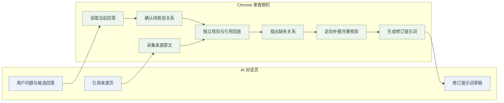
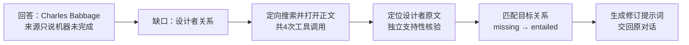
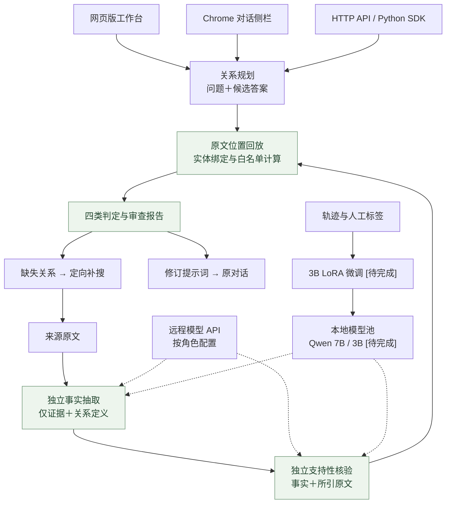

<div align="center">

# Evidence Verifier

**让 AI 的回答有据可查，让缺失的证据有处可补。**

面向 AI 对话与搜索智能体的证据核验系统。<br>
从回答中确定待核验关系，独立抽取事实、核对引用、绑定跨段实体，再把缺口转成搜索任务和修订提示词。

[](https://github.com/Gump111458785/evidence-verifier/actions/workflows/release-checks.yml)
[](api_edition/README.md)
[](LICENSE)
[](api_edition/README.md)

[网页版与插件版](#2-网页版与插件版) · [补证案例](#3-补证案例) · [系统架构](#4-系统架构) · [核心机制](#5-核心机制) · [后训练](#6-后训练专用证据模型) · [快速开始](#7-快速开始)

</div>

## 1. 解决什么问题

AI 给出了答案，也附上了引用，但引用未必证明答案中的每个关系。多跳问答还可能把两个人的经历连在一起，或把“在某校任职”当成“在某校就读”。

Evidence Verifier 逐条检查这些关系：证据支持哪一步、哪一步仍有缺口、中间实体是否一致。缺证时，系统围绕缺失关系补搜，保留新原文和核验轨迹，生成交回原对话的修订提示词。

| 常见问题 | 处理方式 | 用户得到什么 |
|---|---|---|
| 引用提到了实体，却没有证明目标关系 | 事实抽取与支持性核验分开，逐条核对引用 | 关系结论、原文位置与判断依据 |
| 两条事实各自成立，却接到了不同的人 | 全链变量绑定，检查主体、客体、方向与时间 | 完整证据链或明确的断点 |
| 缺证后不知道该搜什么 | 将缺失关系转成查询，在共享预算内补搜 | 新来源、重核验结果与修订提示词 |

## 2. 网页版与插件版

| | **网页版 · 答案审查工作台** | **插件版 · 对话中的审查助手** |
|---|---|---|
| 使用位置 | 独立浏览器页面 | Chrome 侧栏，与 AI 对话并排 |
| 输入方式 | 粘贴问题、回答片段及来源原文 | 主动读取当前回答，采集用户打开的引用来源 |
| 操作重点 | 创建审查、管理取证任务、查看历史报告 | 核对当前回答、补搜缺口、将提示词填回草稿 |
| 报告内容 | 原文、逐关系结论、引用位置、变量绑定、补搜轨迹 | 当前对话的关系链、证据缺口与修订建议 |
| 接入方式 | HTTP API、Python SDK | Chrome MV3 扩展，连接本机核验服务 |

### 2.1 网页版：集中查看答案、证据与报告


工作台按“工作概览 → 答案审查 → 取证任务 → 审查记录”组织。审查报告分别保留初始核验与补搜结果，支持刷新恢复、原文回放和 JSON 导出。

### 2.2 插件版：沿着当前对话完成核验与补证



插件读取页面可见回答与引用，不读取隐藏思维链。用户确认后才提交核验；提示词只填入空白草稿，由用户发送，不覆盖已有内容。

| 对话平台 | 交互范围 |
|---|---|
| ChatGPT | 单案例覆盖回答读取、来源采集、关系规划、核验、提示词及草稿写入 |
| Gemini | 对话读取、引用采集与草稿写入的实机兼容 [待完成] |
| Claude | 对话读取、引用采集与草稿写入的实机兼容 [待完成] |

[插件操作说明](docs/conversation-sidecar.md) · [工作台使用说明](docs/product-workbench.md)

## 3. 补证案例

### 3.1 谁设计了 Analytical Engine？引用没有回答“谁”

用户在 AI 对话中提问：**“Who designed the Analytical Engine?”** AI 给出候选答案 **Charles Babbage**。审查时先输入一句来源原文：

> The Analytical Engine was never completed.

这句话只说明机器没有完成，不能证明设计者。核验器因此指出缺失关系：

```text
Analytical Engine ── designed_by ──> Charles Babbage
                         ↑
                  当前原文没有支持
```

系统围绕设计者关系补搜，执行 **1 次 search、3 次 open**，从返回的网页正文定位到：

> Charles Babbage commenced work on the design of the Analytical Engine in 1834.

抽取器在不读取问题、候选答案和目标关系的条件下取得事实；支持性核验器检查引用是否真正支持设计关系，程序再回放字符位置、匹配主体与客体。该轮目标关系由 `missing` 变为 `entailed`，生成包含新证据与核验记录的补充提示词。



同批事实中，“Babbage 在 Cambridge 学习”获得支持，“Babbage 在 Cambridge 受雇”仍为缺失；错误设计者、主客体互换、学会会员推雇佣三个目标也没有被放行。引用相关，不等于关系成立。

本例使用 DeepSeek Flash 与真实搜索 API，输入为受控缺证材料；它说明一次关系补证的具体过程，不代表问答准确率提升。后续续测出现的空抽取与无效输出连同成功记录一并保留。[原始案例与费用](docs/web-grounding-validation-2026-11-02.md) · [续测记录](docs/product-workbench.md#本轮真实api续测与边界)。

## 4. 系统架构



问题与候选答案只进入关系规划；抽取器和支持性核验器使用独立的证据输入。各角色可配置不同模型，纯 API 路径无需本地 GPU。

## 5. 核心机制

| 组件 | 做法 | 代码 |
|---|---|---|
| 候选不可见抽取 | 抽取器只看证据和12类关系定义，避免围绕候选答案挑事实 | [engine.py](app/engine.py) |
| 引用内独立核验 | 逐事实核对引用是否支持关系、角色与时间，实体命中不替代语义判断 | [grounding.py](app/grounding.py) |
| 跨关系变量绑定 | 必要关系必须连接同一实体；年份加减与日期区间使用白名单计算 | [relations.py](app/relations.py) |
| 有界引用补齐 | 显式启用同文档前后各2句、额外最多600字符的补齐；保留中间句，最多一次模型定位修正 | [配置说明](api_edition/README.md) |
| 缺口驱动补搜 | search/open/find 共用工具预算，保存原文、来源、范围及重核验轨迹 | [repair.py](app/repair.py) |
| 缓存与请求合并 | 按模型版本、证据、提示词与 schema 隔离缓存，合并相同并发请求 | [inference.py](app/inference.py) |

结果区分 `entailed / missing / contradicted / ambiguous`。格式错误、引用定位失败、不支持的关系与运行失败单列，不计作缺证。

## 6. 后训练：专用证据模型

### 6.1 微调哪些模型

首轮只微调 **Qwen2.5-3B-Instruct**，从同一底座分别训练抽取与核验两个 LoRA adapter。两个任务单独验收、组合对照，避免把抽取错误与支持性判断错误混在一起。[待完成]

| 模型 / 产物 | 任务与训练选择 |
|---|---|
| Qwen2.5-3B-Instruct + `extractor-lora` | 输入仅含原文和关系定义；输出主体、关系、客体、极性、时间限定及引用ID。训练证据内完整抽取，保留合法的空事实输出 [待完成] |
| Qwen2.5-3B-Instruct + `verifier-lora` | 输入为单条抽取事实及其实际引用；输出支持、缺失、矛盾或歧义及依据。不得收到原问题、候选答案或目标关系 [待完成] |
| Qwen2.5-7B-Instruct | 保持冻结，承担关系规划、搜索与回答；作为系统端固定基线，不与3B同时改动 |
| Qwen2.5-14B-Instruct | 保持冻结，用于候选标注和直接裁判对照；其标签仍需原文校验与人工审核 |
| Llama 8B | 保留历史跨模型对照，首轮不增加训练分支 |

实体跨跳绑定、字符位置回放和年份运算继续由程序完成，不让微调模型替代规则内核。只有3B容量受限且数据/提示词修复无效时，才增加7B核验模型的同协议对照；搜索策略的DPO/GRPO不纳入首轮。

底座采用[Qwen官方模型卡](https://huggingface.co/Qwen/Qwen2.5-3B-Instruct)。3B采用[Qwen Research License](https://huggingface.co/Qwen/Qwen2.5-3B-Instruct/blob/main/LICENSE)，研究训练与商用发布分别核对授权，不能按仓库自有代码的MIT许可分发权重。

### 6.2 训练数据与监督目标

从[MuSiQue](https://github.com/StonyBrookNLP/musique)与[HotpotQA](https://hotpotqa.github.io/)训练材料构建约5,000条监督记录，抽取样本和逐事实核验样本分别计数。先按原问题、来源文档和变体家族分组划分训练/验证，再生成负例；同组材料不跨集合。关系schema仅由训练材料设计，冻结后再接触[2Wiki](https://github.com/Alab-NII/2wikimultihop)评测。[待完成]

| 数据来源 | 采样方案与质检 |
|---|---|
| Gold支持事实，约40% | 由支持段落还原原子关系；问题的supporting facts不能直接充当全部关系的精确标签，补齐角色、时间与原文引用 [待完成] |
| 智能体真实错误，约30% | 收集工具调用后的漏抽、错绑、关系误推、时间混淆与无效输出；纠正后形成监督目标，不把失败原输出当金标 [待完成] |
| 合成困难负例，约30% | 角色互换、任职/教育替换、区域/省份替换、亲子/祖孙替换、删证与干扰实体；删证只标缺失，有明确反证才标矛盾 [待完成] |

14B生成候选标签后，程序检查引用可定位、实体角色和JSON合同，人工抽检10%；争议样本双标，报告一致率与Cohen’s κ。核验数据单独控制四类分布；抽取数据标注全文内符合schema的事实，不能只标问题需要的那一条。无关证据允许输出空列表，同时保留大量真实支持正例，防止靠“全空抽取、全部拒绝”提高表面成绩。[待完成]

训练记录采用 `system / user / assistant` 三段消息，`task`区分`extract`与`verify`，保存来源组、标签来源及证据哈希。抽取输出监督结构化事实与引用ID，原始字符位置由程序物化；核验输出监督四类判定与引文内理由。训练不依赖原AI的隐藏思维链。

### 6.3 怎么微调

使用 **Transformers + PEFT 的 bf16 LoRA SFT**：冻结底座，只更新低秩参数；抽取和核验分别从原底座开始训练，保存成两个adapter，不把第二个任务接在第一个adapter上继续覆盖。[待完成]

| 项目 | 首轮配置与对照 |
|---|---|
| LoRA | 从代码中的`q_proj/v_proj`、`r=16`、`alpha=32`、`dropout=0`起步；再对照全线性层adapter和`r=32`，其余条件固定 [待完成] |
| 优化 | AdamW，初始学习率`2e-4`，micro-batch=1，梯度累积8，单卡有效batch=8；按验证集选择学习率`1e-4/2e-4`及1–3轮训练 [待完成] |
| 样本长度 | 先用2,048 tokens；超长样本不静默截断。按完整句与引用窗口切分、保留必要前提；长上下文另设4,096-token对照 [待完成] |
| 显存 | 梯度检查点、按长度分桶、128-token分块投影与交叉熵；分别记录allocated/reserved峰值，不预填节省比例 [待完成] |
| 参数选择 | 验证集选adapter、层范围、rank与训练轮数，最终测试集只在配置冻结后运行；3个固定随机种子报告均值与波动 [待完成] |
| GPU安排 | 在3×RTX 5090资源池中顺序完成单卡3B训练，空闲资源用于评测；不因有三卡就默认三卡DDP或14B与训练同时驻留 [待完成] |

[训练入口](app/training.py)已实现基础LoRA、消息边界对齐、训练预检和独立adapter保存；[损失实现](app/torch_training.py)提供带重计算的分块交叉熵。只对输出token监督，检查chat template的前缀对齐，避免训练到提示词或错误切分的答案边界；做法参照[PEFT LoRA](https://huggingface.co/docs/peft/en/package_reference/lora)与[TRL SFT](https://huggingface.co/docs/trl/en/sft_trainer)，运行路径以本仓库自有训练循环为准。

配置中的`optimizer_steps=20`用于小规模流程检查，不是正式训练轮数。全线性层、超参数扫描、验证集选优、定期checkpoint与恢复能力需补入正式实验入口。[待完成]

### 6.4 怎样确定微调成功

loss下降和adapter文件生成只说明训练执行过。采用“工程正确 → 开发门槛 → 独立效果 → 系统收益”四道验收，任何一道失败都不发布替换模型。[待完成]

| 验收层 | 条件 |
|---|---|
| 工程正确 | 梯度和loss有限，LoRA权重实际变化，冻结底座不变；保存/重载后的固定输入输出一致；分块损失与标准损失在小批次上的数值、梯度对齐 [待完成] |
| 开发门槛 | 冻结80题联合正确≥72/80，正负各≥36/40，16个变量绑定例全对，无无效输出，关键负例零误放行；旧70题用于开发回归 [待完成] |
| 独立核验 | 相比未微调3B，联合正确率提升的配对bootstrap 95%区间下界>0；支持正例召回的差值下界≥−3个百分点，且错误放行率不升。该3个百分点为预先约定的非劣界限，不是成绩 [待完成] |
| 系统收益 | 同输入、同检索库、同6次工具预算下，“答案正确且证据充分”相对自由重搜有配对提升；同时报告实际延迟与成本，不能靠多搜获得优势 [待完成] |

当前训练预检读取80题门槛报告；正式执行前需要可靠的开发核验器及经审查数据。训练后的候选模型再次跑同一门槛，不改变期望答案使其过关。先按独立验证规则选定候选，再锁定最终测试；不反复查看测试结果调参。

### 6.5 评估什么、怎样对照

| 层级 | 数据与指标 | 对照与归因 |
|---|---|---|
| 抽取 | 事实三元组Precision/Recall/F1、引用定位有效率、角色/时间正确率、支持证据中的空抽取率；需逐文档事实金标 [待完成] | 只换抽取adapter，核验器和匹配代码固定；诊断漏抽、幻觉事实及候选诱导 |
| 支持性 | 四类Macro-F1与混淆矩阵；错误放行率=`FP/(FP+TN)`；支持召回=`TP/(TP+FN)`。分母固定，非法输出不丢弃 [待完成] | 用相同人工事实与引用输入对照原3B、LoRA 3B及14B，隔离上游抽取误差 |
| 联合核验 | 独立600题，MuSiQue/HotpotQA/2Wiki各200；判定、引用、角色及绑定全部正确才计成功。每类矛盾/歧义不少于60，分层比例单独披露 [待完成] | 四组：都不微调、只微调抽取、只微调核验、两个都微调；加14B直接裁判。报告关系覆盖率，覆盖外不计拒答成功 |
| 分布外 | schema冻结后评测2Wiki；报告同分布/OOD差距与对基线的改进，拆分错绑、关系误推、时间及计算错误 [待完成] | 最终金标人工独立双标、不用14B预标；开发争议由复核解决 |
| 搜索任务 | 300题自然分布；答案EM/F1、证据Precision/Recall、正确且充分比例、平均工具调用数 [待完成] | 无核验、同预算自由重搜、14B直接裁判、3B拆分核验；支持性参照数据集证据并人工核对必要关系，不用自己的核验器给自己评分 |
| 工程成本 | 单题GPU秒、P50/P95延迟、token量、峰值显存、缓存命中率；冷/热缓存分开 [待完成] | 同硬件、同并发、同输入长度与预算；同时报绝对值及变化，成本增加也保留 |

主要指标附bootstrap 95%置信区间，系统任务使用McNemar配对检验；同源变体按来源组重采样。无效输出计联合失败并单报比例，四类混淆矩阵另加“无效/失败”列，不能排除后再算漂亮分数。分层600题不用于推断自然任务发生率，300题自然分布补足系统端观察。[待完成]

首轮消融还包括：屏蔽/不屏蔽问题与候选、移除困难负例、去掉跨跳绑定、关掉定向补搜。用同一底座和同预算区分“机制改进”“微调收益”与“额外搜索”的贡献。[待完成]

### 6.6 微调成果记录

| 结果 | 基线 → 后训练 | 验收证据 |
|---|---|---|
| 抽取事实F1 / 四类Macro-F1 | 【基线】→【adapter结果】 [待完成] | 分阶段预测、逐例错误与金标版本 |
| 600题联合正确率 / 错误放行率 / 支持召回 | 【基线】→【系统结果】 [待完成] | 分母、置信区间、无效输出与关系覆盖率 |
| 2Wiki联合正确率 | 【基线】→【OOD结果】 [待完成] | 冻结schema与数据隔离清单 |
| 同预算正确且证据充分 | 【自由重搜】→【定向补搜】 [待完成] | 300题配对结果、p值及工具轨迹 |
| 显存 / GPU秒 / P95 | 【同负载基线】→【优化配置】 [待完成] | 三种子、硬件、并发与冷/热缓存记录 |

发布物包含两个adapter、底座与tokenizer revision、数据划分/配置/代码哈希、种子、训练日志和评测报告；只公布有来源的成绩。[待完成]

### 6.7 三模型机制对照

Qwen 7B、Llama 8B、Qwen 14B在80题构造诊断与12条补充探针上保留552份原始输出。下表为 **Qwen2.5-14B历史预测的离线复算**，与上方3B微调实验分开计量。

| 指标 | 直接裁判 | 拆分核验 |
|---|---:|---:|
| 联合正确 | 52/80 | 69/80 |
| 无效输出 | 27/80 | 4/80 |
| 正例联合判对 | 39/40 | 32/40 |
| 负例联合判对 | 13/40 | 37/40 |
| 变量绑定案例联合判对 | 16/16 | 11/16 |

拆分核验提高了联合正确与负例判定，正例和绑定表现仍有损失。构造诊断用于开发，不作为独立泛化成绩。[完整结果](docs/evaluation.md)

```bash
python3 scripts/reproduce_diagnostics.py
```

程序回归 **130项通过、3项可选训练依赖检查跳过**；覆盖原文定位、输入隔离、变量绑定、任务恢复、失败分类、插件操作及历史复算。[检查记录](docs/product-workbench.md)

## 7. 快速开始

Python 3.10+，SQLite 支持 FTS5。

```bash
git clone https://github.com/Gump111458785/evidence-verifier.git
cd evidence-verifier
```

### 7.1 启动网页版与核验服务

```bash
python3 -m venv .venv-api
source .venv-api/bin/activate
python -m pip install -r api_edition/requirements.txt
cp -n api_edition/config.deepseek.example.json api_edition/config.local.json
export EV_API_VERIFIER_KEY='填写自己的密钥'
python api_edition/run.py --config api_edition/config.local.json --check
python api_edition/run.py --config api_edition/config.local.json --port 8790
```

打开 **http://127.0.0.1:8790/#audit**，粘贴问题与回答片段，添加来源原文，确认关系后提交。`--check`只检查配置，不发付费请求；核验、规划及补搜按所配API计费。配置可为各角色指定不同的OpenAI兼容服务，密钥通过环境变量提供，不写入仓库。[API配置](api_edition/README.md)

### 7.2 使用插件

从 [Releases](https://github.com/Gump111458785/evidence-verifier/releases) 下载扩展包，或从源码构建：

```bash
python3 app/scripts/build_extension.py --out dist/evidence-verifier-extension.zip
```

1. 解压扩展包，在 Chrome 的 `chrome://extensions` 开启开发者模式，点击“加载已解压的扩展程序”，选择含 `manifest.json` 的目录。
2. 复制扩展ID，填入 `api_edition/config.local.json` 的 `extension_id`，重启核验服务。
3. 在 ChatGPT 对话页打开侧栏，点击“读取当前回答”。
4. 打开引用来源页，主动点击插件图标授权该页，再点“收集当前来源页的原文”。
5. 生成并确认待核验关系，点击“开始独立核验”；缺证时启动定向补搜。
6. 生成修订建议，填入原对话空白草稿，审阅后自行发送。

### 7.3 接入其他应用

HTTP API 提供审查提交、任务观察、取消、恢复与导出；Python SDK和LangGraph适配连接已有搜索流程。[HTTP合同](docs/integration.md) · [SDK](sdk) · LangGraph真实框架集成验收 [待完成]

## 8. 应用接入

| 场景 | 接入方式 |
|---|---|
| AI 对话审查 | Chrome侧栏读取可见回答，采集引用，反馈修订提示词 |
| 搜索智能体 | HTTP核验接口作为回答前检查，缺口驱动补搜 |
| 企业知识库 | 接入内部检索、权限与审查记录管理 [待完成] |
| 训练数据质检 | 逐关系审查候选轨迹，人工复核后筛选训练样本 [待完成] |
| 托管服务 | 多用户认证、租户隔离、网关与运行监控 [待完成] |

核验结论覆盖所声明关系与提供的来源，不自动证明整题完整性或来源客观真实。默认服务监听本机回环地址。

## 9. 文档与开发

| 入口 | 内容 |
|---|---|
| [工作台](docs/product-workbench.md) · [插件](docs/conversation-sidecar.md) | 操作路径、报告与隐私范围 |
| [纯API](api_edition/README.md) · [应用集成](docs/integration.md) | 模型、搜索、扩展ID与接口 |
| [网页补证](docs/web-grounding-validation-2026-11-02.md) · [浏览器记录](docs/browser-validation-2026-11-02.md) | 输入、来源、运行轨迹与费用 |
| [评测](docs/evaluation.md) · [数据](docs/data.md) | 模型对照、标签与指标定义 |
| [路线图](docs/roadmap.md) · [交付](docs/delivery.md) | 实验安排、版本与分发 |

自有代码采用 [MIT License](LICENSE)，IBM Plex 字体采用 [SIL OFL](app/static/fonts/LICENSE.txt)。模型、数据与上游代码遵循各自许可，见 [数据与上游署名](THIRD_PARTY_NOTICES.md)。反馈问题请提交 [Issues](https://github.com/Gump111458785/evidence-verifier/issues)，附上去除密钥及私人对话的日志。
