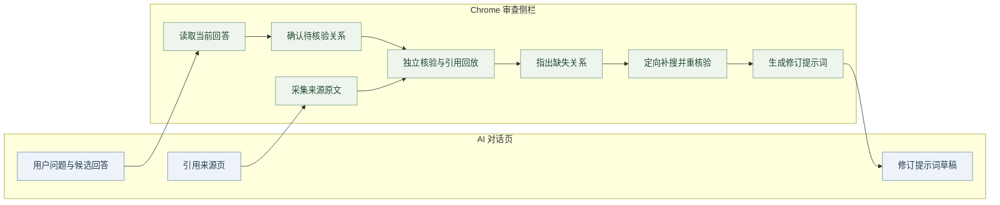
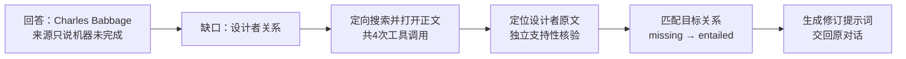
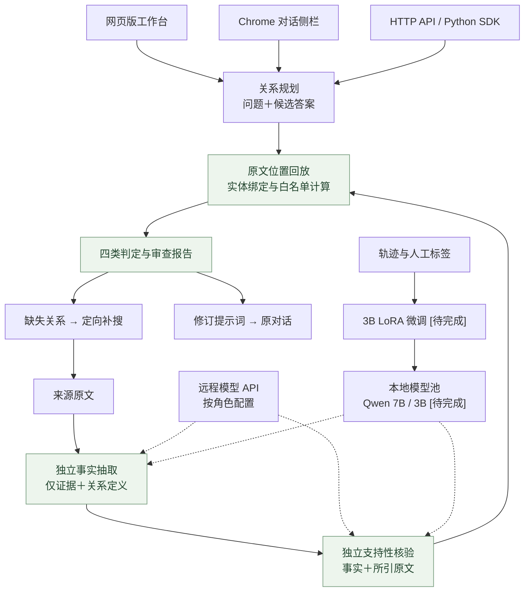

<div align="center">

# Evidence Verifier

**让 AI 的回答有据可查，让缺失的证据有处可补。**

面向 AI 对话与搜索智能体的证据核验系统。<br>
从回答中确定待核验关系，独立抽取事实、核对引用、绑定跨段实体，再把缺口转成搜索任务和修订提示词。

[](https://github.com/Gump111458785/evidence-verifier/actions/workflows/release-checks.yml)
[](api_edition/README.md)
[](LICENSE)
[](api_edition/README.md)

[网页版与插件版](#2-网页版与插件版) · [补证案例](#3-补证案例) · [系统架构](#4-系统架构) · [核心机制](#5-核心机制) · [后训练](#6-后训练让模型更会核对证据) · [快速开始](#7-快速开始)

</div>

## 1. 解决什么问题

AI 给出了答案，也附上了引用，但引用未必证明答案中的每个关系。多跳问答还可能把两个人的经历连在一起，或把“在某校任职”当成“在某校就读”。

Evidence Verifier 逐条检查这些关系：证据支持哪一步、哪一步仍有缺口、中间实体是否一致。缺证时，系统围绕缺失关系补搜，保留新原文和核验轨迹，生成交回原对话的修订提示词。

| 常见问题 | 处理方式 | 用户得到什么 |
|---|---|---|
| 引用提到了实体，却没有证明目标关系 | 事实抽取与支持性核验分开，逐条核对引用 | 关系结论、原文位置与判断依据 |
| 两条事实各自成立，却接到了不同的人 | 全链变量绑定，检查主体、客体、方向与时间 | 完整证据链或明确的断点 |
| 缺证后不知道该搜什么 | 将缺失关系转成查询，在共享预算内补搜 | 新来源、重核验结果与修订提示词 |

## 2. 网页版与插件版

| | **网页版 · 答案审查工作台** | **插件版 · 对话中的审查助手** |
|---|---|---|
| 使用位置 | 独立浏览器页面 | Chrome 侧栏，与 AI 对话并排 |
| 输入方式 | 粘贴问题、回答片段及来源原文 | 主动读取当前回答，采集用户打开的引用来源 |
| 操作重点 | 创建审查、管理取证任务、查看历史报告 | 核对当前回答、补搜缺口、将提示词填回草稿 |
| 报告内容 | 原文、逐关系结论、引用位置、变量绑定、补搜轨迹 | 当前对话的关系链、证据缺口与修订建议 |
| 接入方式 | HTTP API、Python SDK | Chrome MV3 扩展，连接本机核验服务 |

### 2.1 网页版：集中查看答案、证据与报告


工作台按“工作概览 → 答案审查 → 取证任务 → 审查记录”组织。审查报告分别保留初始核验与补搜结果，支持刷新恢复、原文回放和 JSON 导出。

### 2.2 插件版：沿着当前对话完成核验与补证



插件读取页面可见回答与引用，不读取隐藏思维链。用户确认后才提交核验；提示词只填入空白草稿，由用户发送，不覆盖已有内容。

| 对话平台 | 交互范围 |
|---|---|
| ChatGPT | 单案例覆盖回答读取、来源采集、关系规划、核验、提示词及草稿写入 |
| Gemini | 对话读取、引用采集与草稿写入的实机兼容 [待完成] |
| Claude | 对话读取、引用采集与草稿写入的实机兼容 [待完成] |

[插件操作说明](docs/conversation-sidecar.md) · [工作台使用说明](docs/product-workbench.md)

## 3. 补证案例

### 3.1 谁设计了 Analytical Engine？引用没有回答“谁”

用户在 AI 对话中提问：**“Who designed the Analytical Engine?”** AI 给出候选答案 **Charles Babbage**。审查时先输入一句来源原文：

> The Analytical Engine was never completed.

这句话只说明机器没有完成，不能证明设计者。核验器因此指出缺失关系：

```text
Analytical Engine ── designed_by ──> Charles Babbage
                         ↑
                  当前原文没有支持
```

系统围绕设计者关系补搜，执行 **1 次 search、3 次 open**，从返回的网页正文定位到：

> Charles Babbage commenced work on the design of the Analytical Engine in 1834.

抽取器在不读取问题、候选答案和目标关系的条件下取得事实；支持性核验器检查引用是否真正支持设计关系，程序再回放字符位置、匹配主体与客体。该轮目标关系由 `missing` 变为 `entailed`，生成包含新证据与核验记录的补充提示词。



同批事实中，“Babbage 在 Cambridge 学习”获得支持，“Babbage 在 Cambridge 受雇”仍为缺失；错误设计者、主客体互换、学会会员推雇佣三个目标也没有被放行。引用相关，不等于关系成立。

本例使用 DeepSeek Flash 与真实搜索 API，输入为受控缺证材料；它说明一次关系补证的具体过程，不代表问答准确率提升。后续续测出现的空抽取与无效输出连同成功记录一并保留。[原始案例与费用](docs/web-grounding-validation-2026-11-02.md) · [续测记录](docs/product-workbench.md#本轮真实api续测与边界)。

## 4. 系统架构



问题与候选答案只进入关系规划；抽取器和支持性核验器使用独立的证据输入。各角色可配置不同模型，纯 API 路径无需本地 GPU。

## 5. 核心机制

| 组件 | 做法 | 代码 |
|---|---|---|
| 候选不可见抽取 | 抽取器只看证据和12类关系定义，避免围绕候选答案挑事实 | [engine.py](app/engine.py) |
| 引用内独立核验 | 逐事实核对引用是否支持关系、角色与时间，实体命中不替代语义判断 | [grounding.py](app/grounding.py) |
| 跨关系变量绑定 | 必要关系必须连接同一实体；年份加减与日期区间使用白名单计算 | [relations.py](app/relations.py) |
| 有界引用补齐 | 显式启用同文档前后各2句、额外最多600字符的补齐；保留中间句，最多一次模型定位修正 | [配置说明](api_edition/README.md) |
| 缺口驱动补搜 | search/open/find 共用工具预算，保存原文、来源、范围及重核验轨迹 | [repair.py](app/repair.py) |
| 缓存与请求合并 | 按模型版本、证据、提示词与 schema 隔离缓存，合并相同并发请求 | [inference.py](app/inference.py) |

结果区分 `entailed / missing / contradicted / ambiguous`。格式错误、引用定位失败、不支持的关系与运行失败单列，不计作缺证。

## 6. 后训练：让模型更会核对证据

### 6.1 训练要解决什么问题

通用模型容易把“提到了同一个人”当成“证明了同一件事”。例如，原文说某人在一所大学任职，模型却据此认定他在那里就读。我们的训练围绕这类具体错误展开，让模型学会从原文找事实、判断证据能否支持结论，并明确指出缺口。[待完成]

目标是减少错误答案被放行，同时保留对正确答案的识别能力。训练效果还要放回搜索任务中检验：在相同搜索次数下，能否让更多回答既正确，又有充分证据。[待完成]

### 6.2 哪些模型负责什么

| 模型 | 分工 |
|---|---|
| **Qwen2.5-3B** | 训练重点。同一底座分别训练两个专用模块：一个从原文提取事实，一个检查事实是否得到引用支持。两个模块分别测试，便于定位问题 [待完成] |
| **Qwen2.5-7B** | 负责规划、搜索和回答，训练核验模块时保持不变，便于判断收益究竟来自哪里 |
| **Qwen2.5-14B** | 辅助整理候选标签，并作为较大模型的核验对照；候选标签仍需程序校验与人工审核 |

实体是否为同一人、引文是否存在、年份计算是否正确，继续交给程序检查。模型负责理解文字，程序保留可以复查的依据。

### 6.3 用什么材料训练

训练材料约 **5,000条**，来自MuSiQue、HotpotQA，以及搜索智能体运行中暴露的错误。材料包含有充分证据的正确例子、真实错误和专门构造的易混淆例子，例如任职与就读、区域与省份、同名人物错接。[待完成]

每条材料都保留原文与标签来源。程序先检查引用能否定位，人工抽检10%，争议样本由两人复核。同一问题及其改写不跨训练和测试集合，避免模型见过相似题后得到虚高成绩。[待完成]

### 6.4 怎么控制训练投入

采用 **LoRA微调**，在原模型上训练少量新增参数，分别保存事实抽取和证据核验模块。首轮集中训练3B模型，7B和14B保持不变，先验证专用小模型的收益。[待完成]

训练使用3×RTX 5090资源池，先按单卡完成3B训练，再安排评测。通过分批计算、按文本长度组批等方式控制显存占用；实际训练时间、峰值显存和每次核验的开销都纳入报告。[待完成]

### 6.5 怎样判断训练有效

模型能保存、训练误差下降，并不等于产品效果更好。验收围绕下面四个问题展开：[待完成]

| 要回答的问题 | 验证方式 |
|---|---|
| **错误答案有没有更少被放行？** | 用600题人工双人标注的核验集，统计缺证、矛盾等情况被误判为支持的比例 [待完成] |
| **是不是靠一律拒绝取得好成绩？** | 同时检查有充分证据的答案能否被识别；结论、引用和人物关系都正确，才算一次核验成功 [待完成] |
| **换一批材料还能不能用？** | 单独使用未进入训练的2Wiki材料，观察效果变化；模型支持哪些关系也一并披露 [待完成] |
| **放进实际搜索流程有没有帮助？** | 在300题搜索任务上，给各方案相同的6次工具调用预算，对比“正确且证据充分”的回答比例，以及等待时间和计算开销 [待完成] |

对照包括原始3B、微调后的3B和14B直接核验；还会分别测试只训练抽取、只训练核验、两个都训练，以确认改进来自哪个环节。结果报告波动范围，不能用一轮偶然提升替代稳定收益。[待完成]

### 6.6 最终看哪些成果

| 成果指标 | 对产品的意义 | 结果 |
|---|---|---|
| 错误放行率 | 减少把缺证答案当成可靠结论 | 【原模型】→【微调模型】 [待完成] |
| 完整核验正确率 | 结论正确，引用和实体关系也正确 | 【原模型】→【微调模型】 [待完成] |
| 有证据答案的识别率 | 避免过度拒绝，让用户能继续使用正确答案 | 【原模型】→【微调模型】 [待完成] |
| 同预算下正确且证据充分的回答比例 | 判断定向补搜能否真正改善最终回答 | 【自由重搜】→【核验驱动补搜】 [待完成] |
| 单次核验成本与等待时间 | 判断效果收益是否值得增加的开销 | 【对照方案】→【专用模型】 [待完成] |

### 6.7 技术依据与实验记录

历史三模型对照保留了552份输出。在80题构造诊断中，14B拆分核验的完整正确数为69题，直接核验为52题；但拆分后对正确答案的识别和实体绑定也有损失。这些结果用于定位问题，与上方3B微调成果分开记录。[历史评测](docs/evaluation.md)

具体训练参数、数据划分、验收门槛、统计方法和逐项对照见[后训练技术附录](docs/post-training.md)。3B底座使用[Qwen Research License](https://huggingface.co/Qwen/Qwen2.5-3B-Instruct/blob/main/LICENSE)，商用发布需按其授权安排。

## 7. 快速开始

Python 3.10+，SQLite 支持 FTS5。

```bash
git clone https://github.com/Gump111458785/evidence-verifier.git
cd evidence-verifier
```

### 7.1 启动网页版与核验服务

```bash
python3 -m venv .venv-api
source .venv-api/bin/activate
python -m pip install -r api_edition/requirements.txt
cp -n api_edition/config.deepseek.example.json api_edition/config.local.json
export EV_API_VERIFIER_KEY='填写自己的密钥'
python api_edition/run.py --config api_edition/config.local.json --check
python api_edition/run.py --config api_edition/config.local.json --port 8790
```

打开 **http://127.0.0.1:8790/#audit**，粘贴问题与回答片段，添加来源原文，确认关系后提交。`--check`只检查配置，不发付费请求；核验、规划及补搜按所配API计费。配置可为各角色指定不同的OpenAI兼容服务，密钥通过环境变量提供，不写入仓库。[API配置](api_edition/README.md)

### 7.2 使用插件

从 [Releases](https://github.com/Gump111458785/evidence-verifier/releases) 下载扩展包，或从源码构建：

```bash
python3 app/scripts/build_extension.py --out dist/evidence-verifier-extension.zip
```

1. 解压扩展包，在 Chrome 的 `chrome://extensions` 开启开发者模式，点击“加载已解压的扩展程序”，选择含 `manifest.json` 的目录。
2. 复制扩展ID，填入 `api_edition/config.local.json` 的 `extension_id`，重启核验服务。
3. 在 ChatGPT 对话页打开侧栏，点击“读取当前回答”。
4. 打开引用来源页，主动点击插件图标授权该页，再点“收集当前来源页的原文”。
5. 生成并确认待核验关系，点击“开始独立核验”；缺证时启动定向补搜。
6. 生成修订建议，填入原对话空白草稿，审阅后自行发送。

### 7.3 接入其他应用

HTTP API 提供审查提交、任务观察、取消、恢复与导出；Python SDK和LangGraph适配连接已有搜索流程。[HTTP合同](docs/integration.md) · [SDK](sdk) · LangGraph真实框架集成验收 [待完成]

## 8. 应用接入

| 场景 | 接入方式 |
|---|---|
| AI 对话审查 | Chrome侧栏读取可见回答，采集引用，反馈修订提示词 |
| 搜索智能体 | HTTP核验接口作为回答前检查，缺口驱动补搜 |
| 企业知识库 | 接入内部检索、权限与审查记录管理 [待完成] |
| 训练数据质检 | 逐关系审查候选轨迹，人工复核后筛选训练样本 [待完成] |
| 托管服务 | 多用户认证、租户隔离、网关与运行监控 [待完成] |

核验结论覆盖所声明关系与提供的来源，不自动证明整题完整性或来源客观真实。默认服务监听本机回环地址。

## 9. 文档与开发

| 入口 | 内容 |
|---|---|
| [工作台](docs/product-workbench.md) · [插件](docs/conversation-sidecar.md) | 操作路径、报告与隐私范围 |
| [纯API](api_edition/README.md) · [应用集成](docs/integration.md) | 模型、搜索、扩展ID与接口 |
| [网页补证](docs/web-grounding-validation-2026-11-02.md) · [浏览器记录](docs/browser-validation-2026-11-02.md) | 输入、来源、运行轨迹与费用 |
| [评测](docs/evaluation.md) · [数据](docs/data.md) | 模型对照、标签与指标定义 |
| [路线图](docs/roadmap.md) · [交付](docs/delivery.md) | 实验安排、版本与分发 |

自有代码采用 [MIT License](LICENSE)，IBM Plex 字体采用 [SIL OFL](app/static/fonts/LICENSE.txt)。模型、数据与上游代码遵循各自许可，见 [数据与上游署名](THIRD_PARTY_NOTICES.md)。反馈问题请提交 [Issues](https://github.com/Gump111458785/evidence-verifier/issues)，附上去除密钥及私人对话的日志。
