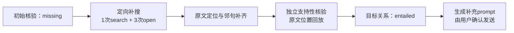
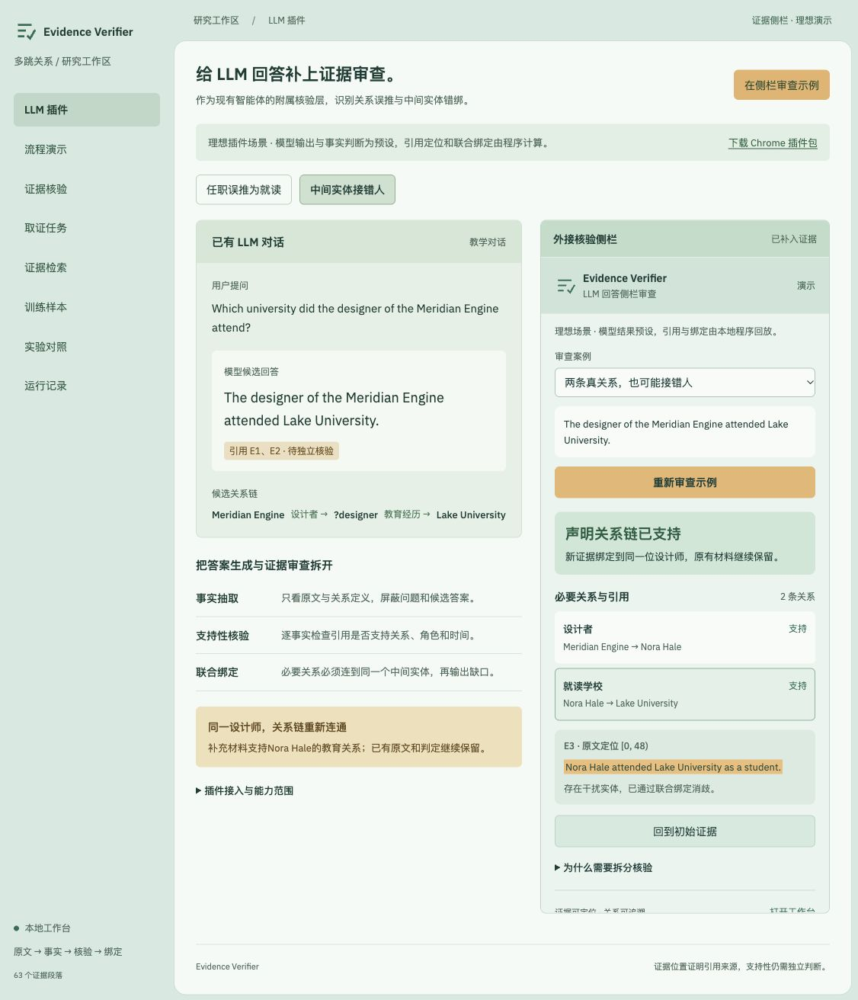

<div align="center">

# Evidence Verifier

**核对 AI 回答的证据，找到缺失关系，再定向补搜。**

面向 AI 对话与搜索智能体的外接证据核验器。<br>
将事实抽取、支持性核验、原文回放与跨关系绑定拆开，生成可追溯的核验记录和补充 prompt。

[](https://github.com/Gump111458785/evidence-verifier/actions/workflows/release-checks.yml)
[](api_edition/README.md)
[](LICENSE)
[](api_edition/README.md)

[系统架构](#系统架构) · [快速开始](#快速开始) · [使用插件](#使用插件) · [真实补证案例](#真实补证案例) · [核心机制](#核心机制) · [实测结果](#实测结果) · [文档](#文档与开发)

</div>

## 三十秒看懂

| 使用中遇到的问题 | Evidence Verifier 的处理方式 | 输出 |
|---|---|---|
| 回答附了引用，却没有证明目标事实 | 屏蔽问题和候选答案抽取事实，再逐条核对引用是否支持关系 | 事实、支持性判定、原文位置 |
| 两跳各自成立，中间却连了不同的人 | 对同一变量进行全链绑定，检查角色、方向与时间 | 完整绑定、缺失关系或歧义 |
| 当前证据不够，不知道接下来搜什么 | 根据缺失关系构造查询，在共享工具预算内补搜并重核验 | 新证据、补搜轨迹、修订 prompt |

可通过Chrome侧栏审查对话，也可通过HTTP API接入已有搜索系统。纯API版使用远程模型与搜索服务，无需本地GPU；教学工作台和历史复算无需密钥。

## 系统架构

下图展示**理想完成态的系统设计**：在线证据核验与定向补搜、可替换的模型资源底座，以及离线训练评测。`实 / 验 / 拟`分别标明已有实现与合同、接入或效果待验收、规划组件。


[放大 / 编辑SVG](docs/images/system-architecture.svg) · [下载PDF](docs/images/system-architecture.pdf) · [架构与数据边界](docs/architecture.md)

问题与候选答案只进入关系规划，事实抽取和支持性核验使用独立的证据输入；本地模型池与远程API按角色配置，可互相替换。3×RTX5090本地路径、3B LoRA及新数据评测属于目标设计，不表示已有对应训练、显存或吞吐成绩。

## 真实补证案例

**问题：Who designed the Analytical Engine?** 候选为Charles Babbage。先提供一条受控缺证输入：`The Analytical Engine was never completed.`，它没有说明设计者。



| 检查点 | 实际观察 |
|---|---|
| 模型与设置 | DeepSeek Flash，非思考模式；输入、期望与运行代码哈希在实测前冻结 |
| 自动网页补搜 | DeepSeek真实搜索返回正文，4次工具调用后完成重核验 |
| 设计者证据 | 新原文明确提及Charles Babbage设计整台Analytical Engine；1条目标证明，引用位置全部可回放 |
| 独立语义核验 | 同批抽取中的“在Cambridge学习”获支持，“在Cambridge受雇”仍判缺失 |
| 错误目标检查 | 同批事实下，错误设计者、主客体互换、学会会员推雇佣3项匹配检查均为missing |
| 原对话反馈 | 生成补充prompt，`automatically_sent=false`，由用户审阅后发送 |

这是**一个后端开发案例**；3项负例复用同批事实，不是3次独立端到端任务。此前的定位失败和思考额度耗尽记录保留，未通过修改标签或丢弃无效事实使测试过关。[冻结输入、修复过程与费用](docs/web-grounding-validation-2026-11-02.md)。

## 工作台与侧栏

<p align="center">
  
</p>

图中为本机**教学案例**：模型抽取与支持性判定采用预设，原文位置与联合绑定由程序执行。可在工作台体验“任职推就读”“中间实体错绑”两个场景；真实API案例的依据见上方实测记录。

## 核心机制

| 组件 | 具体做法 | 实现与依据 |
|---|---|---|
| **候选不可见的事实抽取** | 规划器看问题与候选；抽取器只看证据和12类关系定义，避免按待验证答案寻找事实 | [推理流程](app/engine.py) · [输入隔离测试](api_edition/tests/test_provider.py) |
| **引用内独立核验** | 核验器逐条检查事实实际引用的句子；实体字符串命中后，仍需判断关系、角色与时间是否成立 | [原文处理](app/grounding.py) · [回归测试](app/tests/test_grounding.py) |
| **程序化回放与绑定** | 校验原文字符位置，将多跳变量绑定到同一实体；年份加减、日期区间只走白名单运算，不执行模型生成代码 | [关系绑定](app/relations.py) · [共享内核](app/vendor/evpilot/relation_kernel_v7.py) |
| **有界原文补齐** | 可显式启用同文档前后各2句、额外最多600字符的引用补齐；保留中间句，仍无效时最多一次模型定位修正 | [配置与计费边界](api_edition/README.md) · [修正约束测试](app/tests/test_grounding.py) |
| **缺口驱动的补搜** | 将缺失关系转成查询，search/open/find共享工具预算，保留来源、字符范围和重核验记录 | [补搜任务](app/repair.py) · [检索合同](app/tests/test_retrieval.py) |
| **版本缓存与请求合并** | 按模型revision、证据、提示词及schema隔离缓存，合并相同并发请求；未固定模型版本时限制复用 | [推理调度](app/inference.py) · [架构说明](docs/architecture.md) |

输出区分`entailed / missing / contradicted / ambiguous`。无效格式、定位失败、不支持的关系和运行失败单列，不计作“证据不足”。缓存、并发合并和路由已有实现与合同测试，真实显存、吞吐及费用收益尚未测量。

## 快速开始

Python 3.10+，SQLite需支持FTS5。以下从当前main源码启动，旧v0.3.2 Release保留原样，尚未包含最新网页核验与ChatGPT适配修复。

```bash
git clone https://github.com/Gump111458785/evidence-verifier.git
cd evidence-verifier
```

### 方式一：先体验教学工作台

```bash
python3 app/server.py --port 8790
```

打开 **http://127.0.0.1:8790/#plugin**，选择案例、审查关系链、补入教学证据。无需GPU、模型权重或密钥；页面会标明预设结果。

### 方式二：接入真实模型与网页搜索

在独立环境安装CPU端校验依赖，首次配置时复制模板；已有`config.local.json`时直接编辑，保留现有配置。

```bash
python3 -m venv .venv-api
source .venv-api/bin/activate
python -m pip install -r api_edition/requirements.txt
cp -n api_edition/config.deepseek.example.json api_edition/config.local.json
```

配置默认使用DeepSeek；也可按[API说明](api_edition/README.md)为规划、抽取、核验配置不同的OpenAI兼容服务。密钥通过环境变量提供，不能写进配置或提交到仓库。

```bash
export EV_API_VERIFIER_KEY='填写自己的密钥'
python api_edition/run.py --config api_edition/config.local.json --check
python api_edition/run.py --config api_edition/config.local.json --port 8790
```

打开 **http://127.0.0.1:8790/sidecar.html**。`--check`只检查配置，不调用付费API，也不验证密钥有效性。真实核验、关系规划及补搜可能计费；启动器不会自动读取`.env.local`。

### 方式三：嵌入已有应用

提供HTTP核验任务、Python SDK和LangGraph节点代码，支持任务观察、恢复与报告导出。[接入示例与合同](docs/integration.md) · [SDK](sdk)。HTTP合同已有测试，SDK和框架的真实服务集成仍待验收。

## 使用插件

**从当前main构建插件**，无需安装浏览器打包工具：

```bash
python3 app/scripts/build_extension.py --out dist/evidence-verifier-extension.zip
```

1. 解压ZIP，在Chrome的`chrome://extensions`开启开发者模式，选择“加载已解压的扩展程序”，选中`manifest.json`所在目录。构建脚本保留旧包；重复构建请换新的输出文件名。
2. 复制扩展ID，填入`api_edition/config.local.json`的`extension_id`，重启上述API服务。
3. 在ChatGPT对话页点击工具栏插件图标，再点**「读取当前回答」**。
4. 打开引用来源页，再次点击插件图标授权该页，选择原文并点**「收集当前引用来源页的原文」**。
5. **生成关系草稿 → 人工确认 → 提交独立核验**；结果缺证时可点**「定向补搜并重核验」**。
6. **生成补充prompt → 填入原对话草稿 → 自行发送**。插件不自动发送，不覆盖已有草稿。

| 网页端 | 实机状态 |
|---|---|
| ChatGPT | 单案例页面读取、原文采集、关系规划、核验及草稿写入通过 |
| Gemini | 地区限制阻断，尚未验收问答界面 |
| Claude | 按要求未测试 |

只读取页面可见内容，不读取隐藏思维链或完整内部检索历史；“跟随页面更新”只更新预览，不自动调用核验模型。[完整操作与隐私范围](docs/conversation-sidecar.md) · [浏览器实机记录](docs/browser-validation-2026-11-02.md)。

## 实测结果

### 当前API链路与工程检查

| 验证对象 | 范围与结果 | 依据 |
|---|---|---|
| 自动网页补搜 | 1个受控缺证开发案例从missing到entailed，生成修订prompt | [输入与实测](docs/web-grounding-validation-2026-11-02.md) |
| DeepSeek用量 | 连同此前失败累计36次模型调用、7次搜索，峰值计价保守估算$0.043863 | [费用口径](docs/web-grounding-validation-2026-11-02.md) |
| 程序回归 | 本机123项通过、3项可选训练依赖缺失跳过；CI通过 | [验证记录](docs/web-grounding-validation-2026-11-02.md) · [对应CI](https://github.com/Gump111458785/evidence-verifier/actions/runs/41406656853) |

用量包含开发失败和重测，不能作为产品单题成本；程序测试通过也不代表模型准确率。

### 历史三模型诊断

80题构造开发诊断，另有12条补充探针；保留Qwen 7B、Llama 8B、Qwen 14B在两种流程下的552份原始输出。下表为**Qwen2.5-14B旧预测的离线复算**，不是当前API版的新成绩。

| 指标 | 直接裁判 | 拆分核验 |
|---|---:|---:|
| 联合正确 | 52/80 | 69/80 |
| 无效输出 | 27/80 | 4/80 |
| 正例联合判对 | 39/40 | 32/40 |
| 负例联合判对 | 13/40 | 37/40 |
| 变量绑定案例联合判对 | 16/16 | 11/16 |

拆分核验的联合正确和负例判定改善，但正例与变量绑定退步，**未达到原有门槛**。这些数据只用于开发诊断，不是独立泛化验证；无效输出包括格式、定位和事实物化失败。[三模型完整结果与评分口径](docs/evaluation.md)。

```bash
python3 scripts/reproduce_diagnostics.py
# 可选：保存逐例评分到新文件，不覆盖旧结果
python3 scripts/reproduce_diagnostics.py --out diagnostics-report.json
```

脚本校验冻结哈希，从原标签和逐条预测重算结果，只需标准库，不加载模型或调用API。

## 后续计划与适用范围

当前交付包含教学工作台、纯API启动器、Chrome侧栏及历史诊断复算。企业知识库核验、搜索系统接入和训练数据审查是目标场景，尚无客户或商业化验收。

下一步先完成代表性核验与同预算搜索对照，再评估专用模型训练：600题人工双标、300题搜索任务均是计划规模，尚未形成对应独立评测成绩。LoRA预检和分块交叉熵已有代码，3B训练尚未启动；别名消歧、可靠自动轨迹过滤、托管云API与企业部署尚未实现。[完整能力状态](docs/implementation-status.md) · [验收门槛与路线图](docs/roadmap.md)。

核验结论只覆盖人工确认的声明关系，不能自动证明整题覆盖、答案全部正确或来源客观真实。服务仅监听本机；API版未配置时明确报错，不以教学结果代替真实推理。

## 文档与开发

| 入口 | 内容 |
|---|---|
| [纯API接入](api_edition/README.md) · [浏览器插件](docs/conversation-sidecar.md) | 模型、搜索、扩展ID、使用步骤与计费边界 |
| [架构](docs/architecture.md) · [HTTP / SDK](docs/integration.md) | 数据流、模块、缓存与应用接入 |
| [真实网页案例](docs/web-grounding-validation-2026-11-02.md) · [浏览器记录](docs/browser-validation-2026-11-02.md) | 成功、失败、输入冻结与实机范围 |
| [评测](docs/evaluation.md) · [数据](docs/data.md) | 历史输出、标签、联合指标与离线复算 |
| [能力状态](docs/implementation-status.md) · [路线图](docs/roadmap.md) | 已实现行为、待验收项及后续实验 |
| [项目愿景](docs/vision.md) · [迭代历史](docs/history.md) · [交付](docs/delivery.md) | 使用场景、版本与分发说明 |

自有代码采用[MIT License](LICENSE)，IBM Plex字体采用[SIL OFL](app/static/fonts/LICENSE.txt)。模型、数据与上游代码遵循各自许可，见[数据与上游署名](THIRD_PARTY_NOTICES.md)。问题反馈请提交[Issues](https://github.com/Gump111458785/evidence-verifier/issues)，附上已去除密钥和私人对话的配置与日志。
