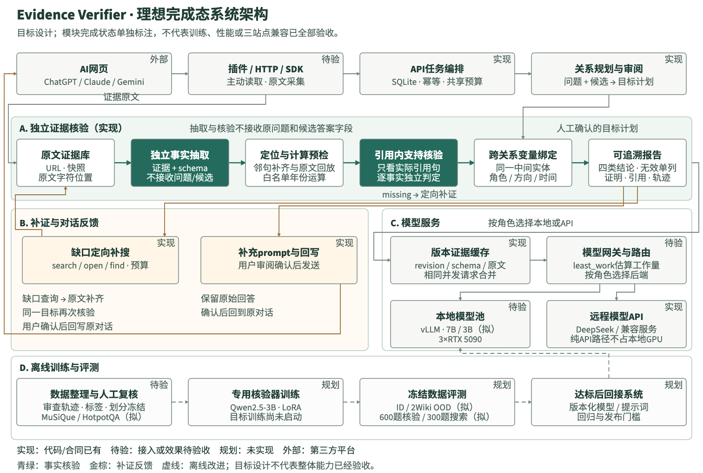
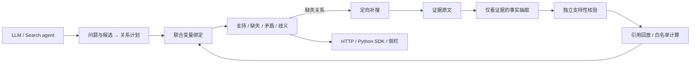

# 系统架构与目标设计

## 理想完成态

[可编辑SVG](images/system-architecture.svg) · [PDF](images/system-architecture.pdf) · [完整实现状态](implementation-status.md)

这是目标架构，组件状态以`实现 / 待验 / 规划 / 外部`标注：已有代码与合同、接入或效果待验收、尚未实现、第三方平台。核心六个组件的相同状态统一放在A区标题。青绿色突出事实抽取、独立支持性核验和事实主链，金棕色仅表示补证反馈；虚线只表示离线改进。外部平台出现在图中不代表已通过实机兼容验收。

图按A核验、B补证反馈、C模型服务、D离线改进组织。补证与模型服务并排展示，模型网关向本地池、远程API分别分叉；保持原有20个组件、22条逻辑连接，布局调整不改变输入隔离或验收状态。

| 部分 | 目标职责与输入边界 | 当前依据 |
|---|---|---|
| 接入与任务编排 | 插件主动读取可见对话并采集原文；HTTP/SDK复用持久化任务与共享预算。问题和候选进入可审阅关系计划 | ChatGPT单案例交互通过；SDK实机集成待验收，Gemini阻断，Claude未测 |
| 独立核验内核 | 原文→独立抽取→定位/计算预检→引用内语义核验→全链变量绑定→报告；目标计划只进入匹配 | 数据合同与程序回归已有；真实网页单开发案例通过，代表性质量待评测 |
| 补搜与回写 | 有效missing按缺失关系补搜，将来源正文加入证据库；有效核验记录生成prompt，由用户确认发送 | search/open/find、工具预算与报告代码已有；不自动提交原AI对话 |
| 模型与资源底座 | 统一角色调用、版本缓存与并发合并；least_work路由接入本地池或远程API，二者不是串行步骤 | 远程API已有实测；本地性能、GPU均衡和收益待验收 |
| 离线改进 | 审查轨迹与人工标签经划分冻结、LoRA、独立评测和发布门槛后再接回服务 | 样本整理和训练预检部分代码已有；3B目标训练尚未启动，新评测规模为规划 |

本地目标池沿用3×RTX5090，图中7B生成与3B核验是目标分工，不预设单卡显存容量、不表示全部模型同时驻留。纯API模式不使用本地GPU。缓存命中、队列合并和路由代码不能替代同负载下的显存、吞吐、P95或费用实测。

离线数据方案以MuSiQue/HotpotQA训练材料为基础，冻结关系定义后再接触2Wiki分布外评测；600题核验、300题同预算搜索对照仍为计划规模，尚无对应独立成绩。图中的“达标后回接”是验收依赖，不是已发布checkpoint。训练不能用核验器自己的结论作为独立金标。[实验门槛](roadmap.md) · [历史评测口径](evaluation.md)。

图中将语义核验和绑定展开为主路径：定位和受限计算的前提先接受程序检查，核验器再收到计算对象与各事实所引原文。无效假设不通过丢弃来修复；未修复错误仍单独记录。图未逐条绘制日志回写和缓存响应返回线，以保留输入隔离与补搜主路径的可读性。

## 当前模块数据流

目标是检查证据是否支持声明的关系链，而不是根据模型常识猜测答案真伪。

## 核验边界

计划生成器接收问题与候选答案；抽取器只接收证据与关系定义；核验器检查抽取事实和引用。两者信息边界在engine.py和planning.py分离。输入实体类型是约束，不能当成证据。

relations.py将局部匹配扩展为全链变量一致性：同一个?designer必须绑定同一个人；多个候选不会在第一跳任意取首个，后续关系可消歧。多个完整绑定或冲突证据保留歧义。

原文字符位置必须可回放。计算仅允许预先定义的年份加减、区间，程序不执行模型生成代码。格式错误、未支持的关系和运行失败不算missing。

## 服务与数据流

| 模块 | 职责 |
|---|---|
| engine.py + vendor/evpilot | 历史回放、模型适配、独立抽取/核验、原文定位与关系合同 |
| relations.py | 跨关系变量绑定、角色检查、组合歧义与声明范围 |
| retrieval.py | FTS5检索、search/open/find、会话文档句柄与工具预算 |
| agent.py / planning.py / repair.py / workflows.py | 搜索、关系草稿、缺口补搜与持久化完整任务 |
| inference.py | 多副本队列、估算工作量路由、并发请求合并 |
| curation.py | 待审样本、追加修订、分组隔离与冻结SFT导出 |
| verification_api.py / sdk | 独立关系核验任务、逻辑键幂等与客户端恢复 |
| training.py / torch_training.py | 训练预检、LoRA与checkpointed分块交叉熵代码 |
| plugin_scenarios.py / static/plugin.* | 预设案例、真实程序绑定和网页/插件共用视图 |

## 缓存与调度

缓存键包含证据、提示词/schema、内核、模型revision及请求阶段。没有固定模型revision时不跨任务复用未知版本结果。同一计算的并发请求合并到一个Future，缓存命中、合并命中和真实调用分别计数。

least_work按照输入字符和最大输出长度估算排队工作量，不等于真实token计数或GPU负载。调度器连接已有服务，不启动、迁移或自动安装模型。本版本没有测得显存、吞吐或GPU均衡收益。

## 结果含义

`scope=declared_relations_only`：只检查调用者声明的关系。计划是否覆盖完整问题并未自动建立；证据本身是否客观真实也不由此证明。关系输出不能直接作为整题答案正确性金标或训练奖励。
