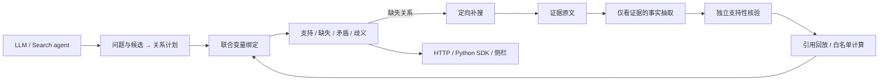

# Architecture

目标是检查证据是否支持声明的关系链，而不是根据模型常识猜测答案真伪。

## 核验边界

计划生成器接收问题与候选答案；抽取器只接收证据与关系定义；核验器检查抽取事实和引用。两者信息边界在engine.py和planning.py分离。输入实体类型是约束，不能当成证据。

relations.py将局部匹配扩展为全链变量一致性：同一个?designer必须绑定同一个人；多个候选不会在第一跳任意取首个，后续关系可消歧。多个完整绑定或冲突证据保留歧义。

原文字符位置必须可回放。计算仅允许预先定义的年份加减、区间，程序不执行模型生成代码。格式错误、未支持的关系和运行失败不算missing。

## 服务与数据流

| 模块 | 职责 |
|---|---|
| engine.py + vendor/evpilot | 历史回放、模型适配、独立抽取/核验、原文定位与关系合同 |
| relations.py | 跨关系变量绑定、角色检查、组合歧义与声明范围 |
| retrieval.py | FTS5检索、search/open/find、会话文档句柄与工具预算 |
| agent.py / planning.py / repair.py / workflows.py | 搜索、关系草稿、缺口补搜与持久化完整任务 |
| inference.py | 多副本队列、估算工作量路由、并发请求合并 |
| curation.py | 待审样本、追加修订、分组隔离与冻结SFT导出 |
| verification_api.py / sdk | 独立关系核验任务、逻辑键幂等与客户端恢复 |
| training.py / torch_training.py | 训练预检、LoRA与checkpointed分块交叉熵代码 |
| plugin_scenarios.py / static/plugin.* | 预设案例、真实程序绑定和网页/插件共用视图 |

## 缓存与调度

缓存键包含证据、提示词/schema、内核、模型revision及请求阶段。没有固定模型revision时不跨任务复用未知版本结果。同一计算的并发请求合并到一个Future，缓存命中、合并命中和真实调用分别计数。

least_work按照输入字符和最大输出长度估算排队工作量，不等于真实token计数或GPU负载。调度器连接已有服务，不启动、迁移或自动安装模型。本版本没有测得显存、吞吐或GPU均衡收益。

## 结果含义

`scope=declared_relations_only`：只检查调用者声明的关系。计划是否覆盖完整问题并未自动建立；证据本身是否客观真实也不由此证明。关系输出不能直接作为整题答案正确性金标或训练奖励。
