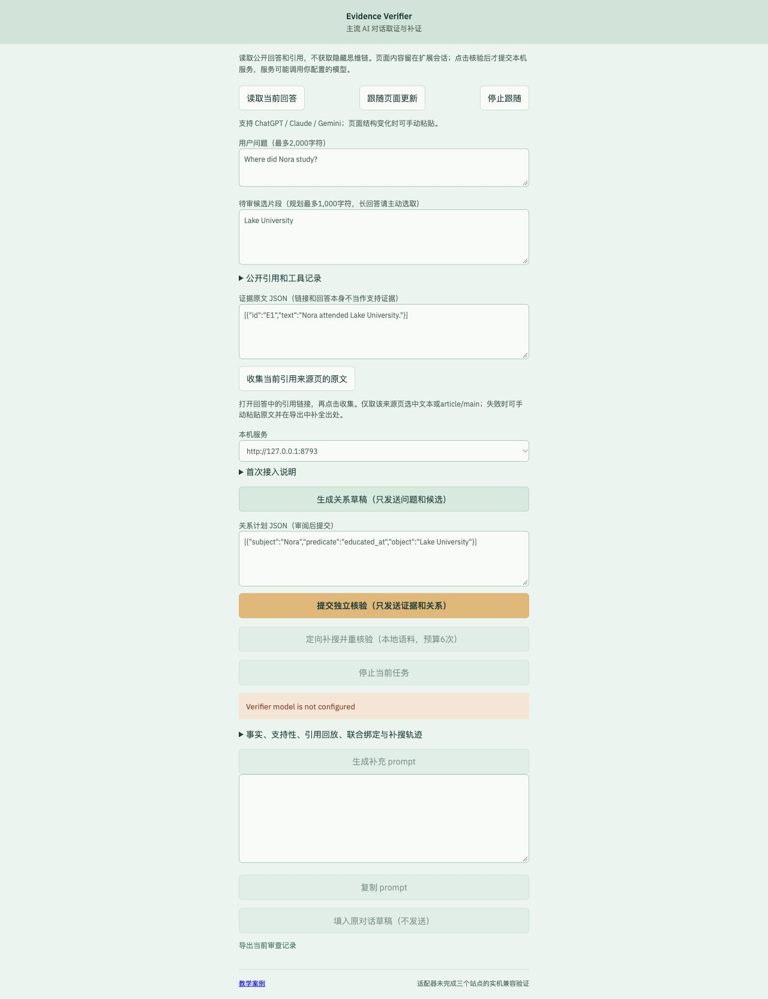

# 对话取证插件 0.2.0

## 工作方式

新侧栏面向ChatGPT（chatgpt.com）、Claude（claude.ai）和Gemini（gemini.google.com）的网页端。适配器只处理可见DOM，选择器可能随站点更新失效；本版本尚未完成三个站点的实机兼容验证。

1. 从Release解压插件，手动加载扩展。点击扩展图标，再主动读取当前回答；“跟随”只更新会话预览，不自动发送模型请求。
2. 查看问题、待审回答、公开引用和可见工具记录。长回答应主动选取最多1,000字符的待审片段；不能把片段核验当作整篇答案通过。
3. 打开已捕获的引用来源页，选中原文或保留article/main区域，点击收集。链接、页面标题、搜索摘要和候选回答本身不被当作原文支持证据。重定向链接或无法解析的页面请手动粘贴原文并保留出处。
4. 点击生成关系草稿：仅发送问题、候选和关系定义；审阅角色、时间、变量和覆盖范围。也可直接手填支持的关系计划。
5. 提交独立核验：只发送证据和声明关系。服务端复用候选不可见抽取、独立支持性核验、原文位置回放与联合绑定；侧栏保留阶段消息与原始JSON。
6. 有效missing结果可触发本地语料的定向补搜，额外预算6次、1轮重核验。它不是互联网全量搜索；默认公开包只有小型诊断语料。缺口报告同时提供用户主动点击的网页搜索链接；搜索词会发送给搜索引擎。新原文收集后应重新核验。
7. 由服务端原始核验/补搜记录生成补充prompt，保留判定、事实、证据、位置与绑定。复制或主动填入原对话草稿，检查后由用户自行发送。该prompt要求原AI补搜、修订、引用并保留不确定性，不请求隐藏思维链。

## 配置

默认侧栏连接本机8790端口，也可切换原部署18790。需要调用方已有的规划与核验模型服务，不安装或下载模型。根据扩展管理页中的实际ID配置：

```bash
export EV_EXTENSION_ID=your-installed-extension-id
# 必须是实际32位a-p扩展ID；占位符不会通过校验。
export EV_MODEL_URL=http://127.0.0.1:8001/v1
export EV_MODEL_NAME=your-existing-verifier
export EV_MODEL_REVISION=your-pinned-revision
export EV_PLANNER_URL=http://127.0.0.1:8000/v1
export EV_PLANNER_NAME=your-existing-planner
python3 app/server.py --port 8790
```

扩展Origin授权精确匹配EV_EXTENSION_ID，默认不接受扩展POST。不开放通配跨域、无需all_urls、无需读取Cookie/账号令牌。activeTab/scripting只在扩展图标、右键等用户操作授权的活动页使用。安装及权限变更由用户手动完成，本项目未代为安装。

## 状态与边界

- 不访问隐藏思维链、模型内部检索管线、私有API或网络响应；可见工具记录不等于完整检索历史。
- 缺少原文、模型未配置、DOM不匹配、无效输出、歧义与运行失败分别显示；不会用教学结果替代真实对话核验。
- 跟随期间答案改变会使旧prompt过期；填入时再次检查原标签页与回答，已有草稿不覆盖，不自动发送。
- 请求ID保存在扩展会话，观察超时可恢复同一个任务；页面重载或输入改变不能重新套用旧结果。导出文件可能含私人对话，是否分享由用户决定。
- 裁判只覆盖声明关系；独立关系计划是否完整、证据客观真伪及准确率提升仍待实测。
- 未读取的远程来源不由服务端自动抓取，避免将任意页面链接当成可访问或可信的证据。

## 新接口

POST /api/sidecar/plans：question、candidate，返回可由GET /api/plan-proposals/:id恢复的任务。规划器不看证据。

POST /api/sidecar/report：verification_id、question、candidate、可选repair_id。只从已完成的服务端核验及同源补搜任务生成缺口和补充prompt。错误或取消的任务拒绝生成报告，不降级为missing。question/candidate是调用者声明的上下文，不是证据或语义金标。

底层继续使用/api/verifications与/api/repair-jobs；没有新增自动训练奖励或质量分数。

提交响应丢失时，核验请求按保留的同一request_key恢复；规划/补搜提交状态未知时不自动重复调用，应在工作台查找原任务。放弃观察并不等于已确认服务端取消。


