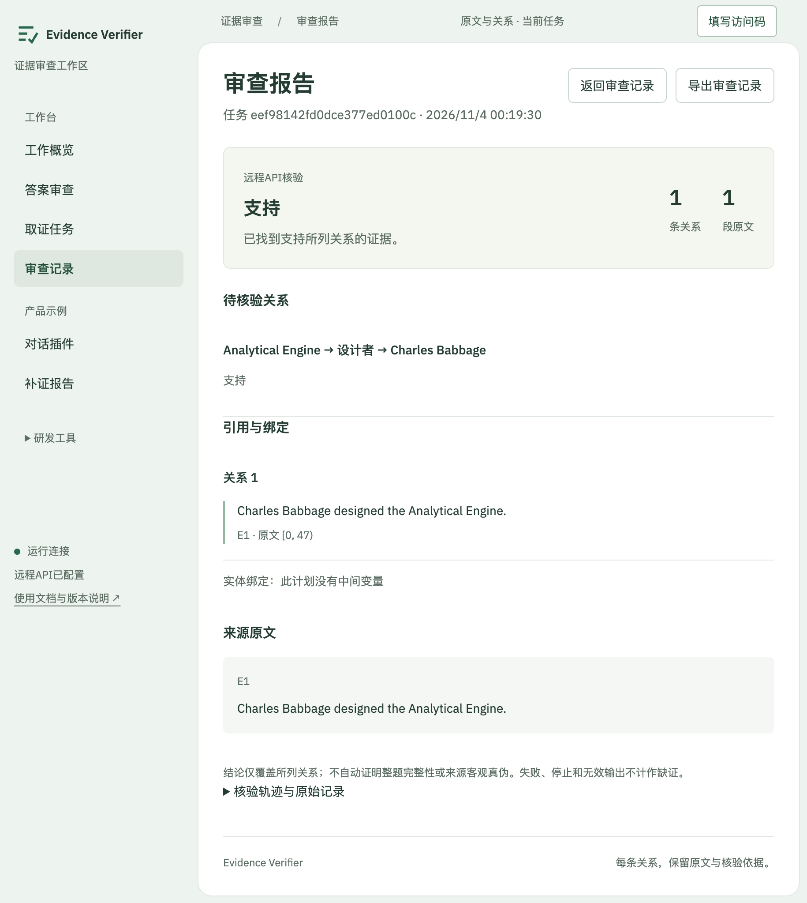

# EdgeOne 云端部署与验收

## 1. 访问与权限

- 工作台：<https://evidence-verifier.edgeone.dev/>
- 答案审查：<https://evidence-verifier.edgeone.dev/#audit>
- 独立审查助手：<https://evidence-verifier.edgeone.dev/sidecar.html>
- 项目控制台：<https://console.tencentcloud.com/edgeone/pages/project/makers-z7l7raqtginj>
- 项目 ID：`makers-z7l7raqtginj`；使用国际站账号、海外部署区域，更新同一项目。

界面、配置状态、历史诊断数据和预设产品示例可免登录浏览。真实操作和私人报告使用独立访问码，点击右上角“填写访问码”；不要填 DeepSeek 密钥。访问码只保存在页面内存，刷新后重新填写；报告在服务端保存。同一访问码的持有者共享其记录，这不是多租户账号系统。

默认域名的中国大陆访问受平台限制，需要三小时有效的签名预览地址；境外可直接访问。本次本机 Chrome 实际打开了默认 HTTPS 域名，终端直连曾返回平台 401。不能据此宣称中国大陆长期免登录访问已验收。用户选择先完成平台域名联调；自定义域名、DNS 和大陆长期公开访问 [待完成]。未购买域名，未交付临时签名链接作为正式地址。[平台域名说明](https://pages.edgeone.ai/document/domain-overview)

## 2. 服务端配置

在项目的 Production 环境配置下列变量；修改后重新部署。变量值不放入前端、ZIP、GitHub、URL、截图或日志。

| 变量 | 用途 |
|---|---|
| `EV_DEEPSEEK_API_KEY` | 服务端 DeepSeek 密钥 |
| `EV_CLOUD_ACCESS_CODE` | 至少24字符的独立访问码；本轮随机生成32字符 |
| `EV_REDIS_REST_URL` | 已有 Redis 的 HTTPS REST 入口 |
| `EV_REDIS_REST_TOKEN` | Redis REST 凭据 |
| `EV_CLOUD_BUDGET_ID` | 固定账本命名空间，跨发布保留 |

本轮复用账号中已有的持久化 Redis，使用 `ev:makers-z7l7raqtginj-trial-01:` 独立命名空间，不修改其他应用数据；未新建付费数据库或订阅。访问码在交付者本机私密文件保管，不在仓库提供。

Redis Lua 脚本原子预留费用，账本和初始化标记不设有效期。任一项缺失、异常或存储不可用时停止付费调用。任务、逐步执行权和报告也由 Redis 持久化；不使用 EdgeOne KV 承担强一致费用计数，因为其同步存在延迟。[KV 说明](https://pages.edgeone.ai/document/kv-storage)

## 3. 模型与费用限制

本轮固定 `deepseek-flash`，关闭思考模式，使用 JSON 输出与本地 schema 校验；不运行本地开源模型、训练或 GPU 调度。网页检索使用固定 DeepSeek Search 端点，仅接收实际返回的正文，摘要不进入已打开证据。

每次供应商 HTTP 请求预留 **0.25 元**，模型与搜索共用 **10 元、最多40次**上限。每次分步 POST 至多发起一个供应商请求；GET 不推进模型。模型输入消息序列化后最多40,000 UTF-8字节，输出最多2,400 token；检索查询最多128字符，每次最多2条结果。无自动重试，超时、失败和结果未知时不退还预留。

按 2026-11-04 官方峰值价：Flash 缓存未命中输入 0.30美元/百万token，输出1.20美元/百万token；Search每千次成功请求0.75美元。预留上界使用10元/美元的保守核算系数，非实时汇率；供应商实际账单与预留分开记录。更换模型、价格或限制后需重新审计上界。不要通过更换命名空间重置本轮账本。[DeepSeek 价格](https://api-docs.deepseek.com/quick_start/pricing/)

## 4. 云端实现范围

| 功能 | 云端处理方式 |
|---|---|
| 关系规划、抽取、独立支持性核验 | 每个模型阶段独立短请求，结构和原文位置校验 |
| 跨关系变量绑定、白名单年份运算 | 复用冻结的 Python 核验内核，不执行模型代码 |
| 定向补搜与搜索任务 | 持久化 search/open/find 会话；按请求推进，保留正文及选取的跨度 |
| 完整取证任务 | 持久化搜索、计划、核验、补搜子任务，工作流共享工具预算 |
| 报告与修订提示词 | 从服务端记录生成；不自动发送至第三方 AI |
| 历史回放、产品示例、评测中心 | 保留历史或预设来源标记，不冒充本次实时结果 |
| 样本整理与冻结导出 | 请求内内存 SQLite 执行原有规则，表数据以 JSON 原子持久化；不写本机数据库、不训练 |
| Chrome 插件 | 现有本机服务接入保留；未新增插件直连此云域名的权限，云端部署不等于插件三平台验收 |

PDF/代码ZIP上传并非该项目原有流程，按用户确认不新增；没有 PDF worker 或 Python PDF 子进程。云函数不启动本地服务、常驻线程或后台队列；浏览器关闭后不继续推进新阶段，重新打开记录可恢复观察。结果未知的步骤永久保留执行权，不重复付费执行。

## 5. 部署构建

```bash
python scripts/build_edgeone.py --out /tmp/ev-edgeone-build-001
edgeone makers deploy /tmp/ev-edgeone-build-001.zip \
  --name evidence-verifier --env production --site global --area overseas \
  --skip-ai-gateway-sync --json
```

使用官方 CLI，先核对账号站点与现有项目。构建输出目录为指定目录，ZIP **根目录包含 `index.html`**；`outputDirectory` 为 `.`。部署包白名单包含静态产物、云函数、核验内核与公开样例，不包含 `.env`、本地配置、运行数据库、用户材料、模型权重或虚拟环境。旧包不覆盖。

构建时将 `.mjs` 扩展名及引用改为 `.js`，JS/CSS 文件名加入内容哈希，HTML 配置重新验证，`.js` 配置 JavaScript MIME。当前静态入口使用普通 JS，不依赖 PDF worker。Python 云函数运行平台支持的 Python 3.10，请求/响应使用 JSON，错误不返回凭据。[CLI](https://pages.edgeone.ai/document/edgeone-cli) · [Python 云函数](https://pages.edgeone.ai/document/python)

## 6. 可核查的验收记录

2026-11-04，真实服务与本机 Chrome 验收；使用公开事实短句，不使用私人对话。

| 检查 | 结果与证据 |
|---|---|
| 免登录首页、内嵌助手 | 已在 Chrome 打开默认HTTPS域名，界面、字体、按钮与 iframe 正常显示 |
| 未授权保护 | 页面未填访问码时，私人记录和会话请求返回401；未触发模型 |
| 真实正例 | 手动输入设计关系与原文，DeepSeek抽取和核验共2次调用，得到 `entailed`，3处原文位置回放通过 |
| 真实缺证例 | 将原文换成“机器没有完成”，相同设计者关系得到 `missing`，1次模型调用；云端记录和浏览器流程均已确认 |
| 报告、修订提示词、导出 | 正例报告显示关系与原文，生成修订提示词，浏览器完成JSON下载；[原始导出](validation/edgeone-positive-2026-11-04.json) |
| 历史与失败留存 | Chrome历史列表同时显示成功及失败任务；第一次部署的JSON索引问题已修复，失败记录保留，不改测试预期 |
| Redis并发硬上限 | 独立无模型验收命名空间48次并发预留：40次成功、8次拒绝；新Store实例仍能读记录，错误owner不可读；未重置生产账本 |
| 配置缺失、超限、供应商失败、输出格式、错误绑定 | CPU契约与冻结内核回归；不将失败或无效输出计成缺证，不将这些测试记作真实模型效果 |
| 部署包泄密检查 | 最终构建递归核对69个ZIP条目与4项真实配置值，无匹配 |
| 刷新与直接报告地址恢复 | 刷新同一补证报告地址后要求重新填写访问码；错误码显示“访问码错误”，正确码恢复原报告并成功导出，未重建任务 |
| 云端网页补搜闭环 | 真实执行1次search、1次open和一轮重核验，初始missing变为entailed；25处位置回放通过，生成包含补证记录的提示词 |
| 本机回归 | 123个后端测试中120通过、3个可选ML测试跳过；另26个API回环测试、10个插件合同测试通过；其中云端专用测试31个，无外部模型调用 |
| GitHub CI | 代码提交516be1b的Release build通过；文档更新后的状态以对应提交Actions为准 |



当前生产账本累计预留 **2.50元/10次供应商请求**：9次模型返回、1次搜索；open读取已保留的正文，不额外调用供应商。四次初始请求包含1次早期运行失败、2次正例和1次缺证；补搜增加1次搜索与5次抽取/支持性核验。无自动重试。

合计输入 **10,215 token**、输出 **581 token**。按官方峰值价、不计缓存折扣、以10元/美元保守换算，包含搜索的估算为 **0.045117元**；供应商实际金额以账单核对，2.50元为预算预留。

补搜返回了[Science Museum Group档案](https://archives.sciencemuseumgroup.ac.uk/Details/archive/110000015)与[IEEE记录](https://www.computer.org/csdl/magazine/an/1998/04/man1998040029/13rRUwInvLo)；本次实际打开前者，提取明确跨度并重新核验，保留原始“未完成”原文。检索返回不等于两个来源都已打开或核验。

浏览器网络面板确认最终主脚本响应为`200`、`Content-Type: text/javascript; charset=utf-8`；字体CSS正常使用304重验证，图标200。已导出正例、补搜侧栏记录以及刷新后的补证报告。详细请求计数见[机器可读验收记录](validation/edgeone-deployment-2026-11-04.json)。

此记录证明一次部署的功能链路和保护措施，不构成模型准确率、训练收益、广泛网页兼容或分布外泛化结论。

## 7. Python SDK 调用

本机版SDK调用保持原行为。云端任务由显式POST推进，`get()`只观察；允许`wait()`推进付费步骤时必须显式选择：

```python
import os
from evidence_verifier import VerifierClient

client = VerifierClient(
    'https://evidence-verifier.edgeone.dev',
    headers={'Authorization': 'Bearer ' + os.environ['EV_VISITOR_ACCESS_CODE']},
    request_timeout=60,
    advance_cloud_jobs=True,
)
result = client.verify(evidence, relations)
```

也可逐次调用 `client.advance(job_id)`，由调用方控制每一步。供应商失败和请求结果未知均不自动重试；观察超时不创建新任务。
