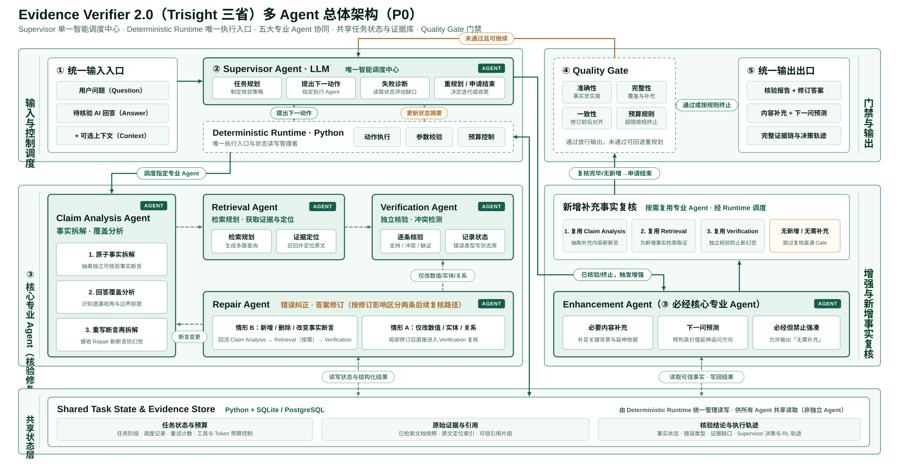

# Evidence Verifier 2.0 架构说明

Evidence Verifier 2.0 采用“1 个监督规划 Agent + 5 个核心专业 Agent + 3 个确定性基础设施”的分层受控闭环架构，将 LLM 的规划与语义能力，与 Python Runtime 的确定性规则校验、状态版本控制解耦。

> 2.0 的运行时、评测管线与策略训练已按 P0–P7 设计实现，因涉及保密暂不开源；实验结果将随论文发布。本文只说明架构与机制，不包含实验数据。

## 角色职责与控制边界（P0–P1）

| 角色 / 基础设施 | 类别 | 核心职责 | 严格边界（禁止越权行为） |
| --- | --- | --- | --- |
| **Supervisor Agent · LLM** | 智能调度 Agent | 全局状态理解、动态任务规划、动作提议（`ActionProposal`）、失败诊断感知重规划 | 唯一智能调度中心；不得直接宣告 `PASS`，不得绕过 Runtime 写状态或越过 Quality Gate |
| **Claim Analysis Agent** | 核心专业 Agent | 原子事实拆解（保留时间/数值/否定限定）、用户 `Requirement` 提取、全文事实覆盖审计 | 不得凭模型参数知识判断事实真伪 |
| **Retrieval Agent** | 核心专业 Agent | 证据需求拆解、查询规划与多跳路径检索、权威原文定位与缺口识别 | 不得将相似检索片段自动判定为支持证据，不得编造 URL/引文 |
| **Verification Agent** | 核心专业 Agent | 双阶段盲抽（Blind Evidence Extraction）+ 事实匹配、多跳实体变量绑定、冲突与充分性判定 | 不得修改原答案；`INSUFFICIENT`（缺证）严禁伪报为正确 |
| **Repair Agent** | 核心专业 Agent | 有证据约束的最小粒度修改（`Replace` / `Remove` / `Qualify` / `Abstain`）与文本差异记录 | 不得依赖内部知识补全事实或重写真文，不得自行认定修订成功 |
| **Enhancement Agent** | 核心专业 Agent（必经） | 必要内容完整性评估、证据约束补充规划、无错误前提的下一问预测（允许合法输出「无需补充」） | 不得未经复核直接发布新增事实，严禁为凑字强行扩写 |
| **Deterministic Runtime** | Python 确定性基础设施 | 动作授权过滤、Pydantic Schema 与引用校对、预算控制、不可变版本与状态机管理 | 唯一执行入口；只认经过校验的正式记录，不替代 Verification 做语义真伪判断 |
| **Shared Task State & Evidence Store** | 共享状态与证据存储 | 持久化 `TextRevision`、`Claim`、`DocumentSnapshot`、`Evidence`、`Verdict`、`RepairRecord` 与决策轨迹 | 非独立 Agent；所有状态由 Runtime 以 `state_version` 事务控制统一读写 |
| **Quality Gate** | 确定性验收门禁 | 校验 6 项发布条件并输出 `PASS / REPLAN / PARTIAL / CLARIFY / FAIL` 裁决 | 纯确定性规则验收，不调用 LLM 主观放行 |

## 核心机制、评测协议与策略学习（P2–P7）

Evidence Verifier 2.0 确立了五项核心工程与研究机制：

1. **所有权隔离与不可变版本流水线（`Draft → Record → ReleaseCandidate`）**：
   - 任何 Agent 输出仅视为候选 `Draft`，必须经 `Deterministic Runtime` 校对原文索引（`source_span` / `quote_span`）、文档哈希（`document_sha256`）及 `state_version` 后才升级为正式不可变 `Record`；
   - 基础答案与补充文本通过统一 `TextRevision`（`BASE_ANSWER` / `SUPPLEMENT`）隔离管理，任一事实修改后历史 `Verdict` 自动失效，杜绝旧结论误用于修订稿。
2. **双阶段盲抽核验（Blind Evidence Extraction）与双维失败诊断（P2）**：
   - `Verification Agent` 内部的证据抽取阶段接口级屏蔽待核验 Claim 与候选答案，先从证据文档中独立抽取出 `EvidenceFact`，再进行 `Claim–Evidence Matching` 与多跳桥接实体一致性检查；
   - 诊断体系将**证据卡点位置**（`NOT_RETRIEVED` / `RETRIEVED_NOT_SELECTED` / `SELECTED_NOT_PRESENTED` / `PRESENTED_NOT_USED`）与**证据充分性**（`INSUFFICIENT`）解耦，为精准调度恢复动作提供明确信号。
3. **基于证据位置的动态恢复与 Repair 双路径复核（P3）**：
   - `Supervisor` 不走僵化固定流水线，而是按合法动作集合、失败位置、预期收益与剩余预算做分层调度与失败感知重规划；
   - `Repair Agent` 修订后严格区分两类复核闭环：**仅修改数值、实体或关系**时局部回流 `Verification`；一旦**新增、删除或改变事实断言**，强制回流 `Claim Analysis → Retrieval（按需）→ Verification`，避免修好旧错却引入新幻觉。
4. **必经增强分析、无前提风险追问与新增事实独立复核（P4）**：
   - 每个任务必须完成一次完整性分析，允许在原回答充分时合法返回零补充/零追问；生成的下一问需通过事实前提安全性检查；
   - 只要 `Enhancement Agent` 输出任何新增事实性补充（`review_scope = SUPPLEMENT`），必须经 `Claim Analysis → Retrieval（按需）→ Verification` 完整复核通过后方可进入 `ReleaseCandidate` 与 `Quality Gate`。
5. **三层独立评测协议与 Supervisor 序列决策学习（P5 / P7）**：
   - **三层评测基准与公平控制**：围绕公共事实验证/多跳集合（FEVER、AVeriTeC、2WikiMultiHopQA、MuSiQue、FActScore 思路）、自建 `Evidence Location & Recovery` 诊断集与端到端审阅集，推行 **Frozen Evidence 对照**、任务级配对统计检验与预算公平性审计，将 **False Trusted Publication Rate（不可信事实误放行率）** 与 **Recovery Success Rate** 作为核心主指标；
   - **SFT → 多步 GRPO 策略优化建模**：在不放松 `Runtime` 与 `Quality Gate` 安全硬边界的前提下，将 `Supervisor` 建模为**受约束部分可观察序列决策问题（`Constrained POMDP`）**，通过 `Legal Action Mask` 与抗投机行为（Anti-reward-hacking）轨迹级奖励设计，优化长程核验恢复与算力成本效率。
