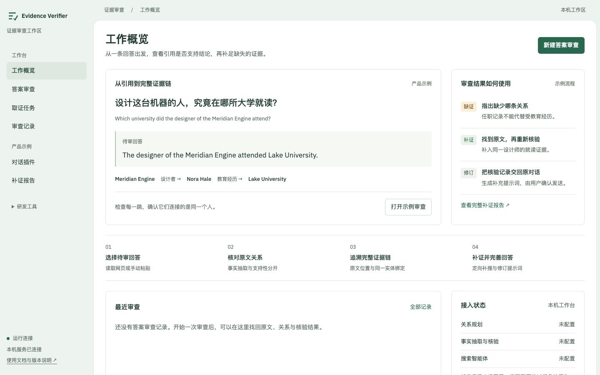
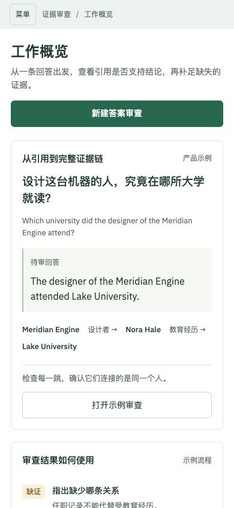
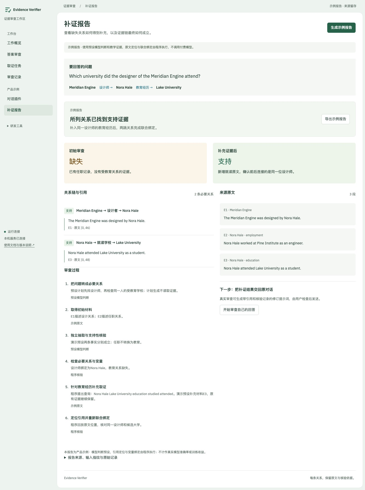

# 答案审查工作台 · v0.3.3

本版围绕“查看回答 → 核对原文 → 找到缺口 → 补证并修订”组织界面。工作概览、审查表单、持久化报告和对话助手均可运行；本机交付不是托管云服务或商业客户验收。

## 三分钟演示

1. 运行 `python3 app/server.py --port 8790`，打开 `http://127.0.0.1:8790/#home`。首页从两跳问答出发，说明为什么任职记录不能证明教育经历；无需密钥。
2. 点“打开示例审查”，在对话插件中运行案例，查看缺少的教育关系，再补入原文，点开引用与变量绑定。这里使用标明来源的预设模型判定。
3. 进入“补证报告”，生成示例报告：逐关系阅读引用、位置与联合绑定，查看执行步骤并导出JSON。模型抽取/判定采用教学预设，原文定位与绑定由程序执行。
4. 若已配置真实API，进入“答案审查”：粘贴问题与回答片段，手动添加来源原文，生成并确认关系，然后提交独立核验。缺证时可显式启动定向补搜；可能计费。
5. 进入“审查记录”重开真实任务，分别查看初始结果与最新关联补搜。复制报告链接可在同一工作区刷新恢复；导出保留两版记录。

教学演示不依赖GPU。真实模式配置见[纯API说明](../api_edition/README.md)；原网页对话操作见[插件说明](conversation-sidecar.md)。不会自动发送修订提示词。

## 导航与实现

| 入口 | 实际行为与来源 |
|---|---|
| 工作概览 `/#home` | GET `/api/plugin-demo`提供示例；GET `/api/health`显示配置；GET `/api/verifications`显示真实审查摘要，不主动调用模型 |
| 答案审查 `/#audit` | 嵌入共享sidecar，支持原文录入/去重、关系草稿确认、独立核验、补搜与修订提示词 |
| 取证任务 `/#agent` | 原搜索智能体任务，保留共享工具预算、状态与取消功能 |
| 审查记录 `/#history` | 独立审查分页，关联最新补搜；实验任务与旧记录保留在折叠区 |
| 对话插件 `/#plugin` | 可交互教学案例：教育经历缺证与同名实体辨别 |
| 补证报告 `/#demo` | 生成教学执行报告，展开原文、引用和步骤，导出原始JSON |
| 研发工具 | 保留历史核验、证据检索、样本管理、评测中心，不作为默认产品入口 |

独立报告深链接为 `/#audit-record/<check-id>/<repair-id>`。失败、取消、无效输出分别展示；最新补搜失败时不能回显旧成功结果。配置“已配置”不等于供应商、密钥或模型质量已验收。原文网址为来源元数据，手动录入不会自动抓网页。

## 界面与操作检查（2026-11-02）

本轮程序回归130项通过，3项可选训练依赖检查跳过：后端89通过/3跳过、API合同26通过、扩展10通过、历史复算5通过。新增测试覆盖审查列表分页、失败/取消不得继承支持结论、最新补搜关联、无效输出分类，以及已知提交拒绝后的任务清理和原文去重。

浏览器检查包括桌面1440、平板768、手机390宽度：首页导航、手动来源录入、去重、关系摘要、未配置模型的错误状态、示例报告双引用、导出、插件补证与菜单。无横向溢出与未捕获脚本错误。另用**离线协议夹具**验证规划→缺证→本地检索→重新核验→提示词→持久报告→导出→刷新恢复；预设响应不代表模型推理质量。

视觉检查采用绿色框架与白色工作区，保留IBM Plex字体。首页布局检查0失败；图表配色告警来自隐藏的历史图表，不是首页展示。流程编号是操作顺序。独立侧栏采用居中窄栏，12px仅用于辅助信息，主要表单及引导已增大。

## 本轮真实API续测与边界

固定问题“Who designed the Analytical Engine?”，候选Charles Babbage，初始来源含明确设计措辞。真实抽取返回空事实，初始核验为missing；继续一次补搜取得4段新证据、使用4次工具调用，随后因抽取或独立核验出现无效输出而失败。没有目标证明引用，不能将空引用校验当作回放成功。界面正确显示失败，报告刷新恢复、初始/补搜两版导出通过，无脚本错误。

本轮保留冻结输入及原始失败，不改测试答案、不重试至通过。此前[一个成功的后端开发案例](web-grounding-validation-2026-11-02.md)仍按原时间范围保留；两者不构成准确率或稳定性评测。

费用快照：包含此前开发失败在内，累计42次模型调用、8次搜索，按保守峰值口径估算USD 0.0503274；按10元/美元估计约人民币0.51元，低于本轮累计3元上限。这不是单题费用、账单结算或固定产品价格。教学与协议检查未调用付费模型。

本轮没有重测ChatGPT实机，没有测试Claude，Gemini仍受地区限制；安装包更新不扩大已有站点兼容声明。未运行模型训练、独立数据集精度评测、GPU吞吐/显存评测或企业部署。
