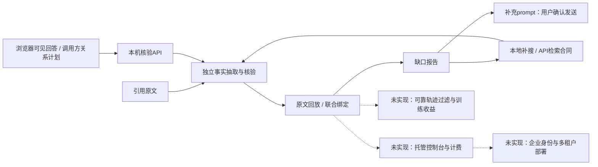

# 落地愿景与当前交付

愿景：让AI答案更容易被证据核查。当前切入点是关系级证据，而非对任意回答给出一个未经校验的总分。

## 四个场景

| 场景 | 产品职责 | 当前状态 |
|---|---|---|
| 企业知识库引用核验 | 提交答案所需关系与原文，返回具体证据和缺口 | 核验API代码与本机合同已实现；SDK接入验收进行中；企业部署未实现 |
| AI搜索与深度研究补证 | 用缺失关系驱动查询、打开正文并重核验 | 本地工具与报告合同已实现；正文搜索API已留接口，真实供应商闭环未验证 |
| 训练轨迹过滤 | 同时检查答对与正确取证，反馈可训练决策 | 有人工整理与导出代码；可靠自动过滤、训练收益未实现 |
| 个人回答审查 | 侧栏查看原文、关系与绑定，生成补充prompt | 界面与三站点适配代码已交付；实机兼容进行中（待验收） |

可先用个人侧栏教学案例演示，再验证API在真实RAG团队中的使用条件。企业/API付费、侧栏获客和部署授权都是商业假设；没有声明客户、收入、试点或上线。

## 完整产品形态

实线表示已有代码路径；虚线表示未实现的产品组件。代码连通不表示真实API/模型效果已测。

## 可信度来自什么

- 历史结果可由`scripts/reproduce_diagnostics.py`离线重新评分；原失败与召回代价保留。
- 程序合同用fixture验证，真实模型质量、站点兼容与商业假设分别说明，不合并成“已实现”。
- 3B目标训练尚未启动；不把“有LoRA代码”写成“已有训练完成模型”。

目前没有同类成本区间、固定费用节省或误放行率目标的独立证据，因此不引用未经核实的竞品结论，也不提供精确的商业收益预测。
